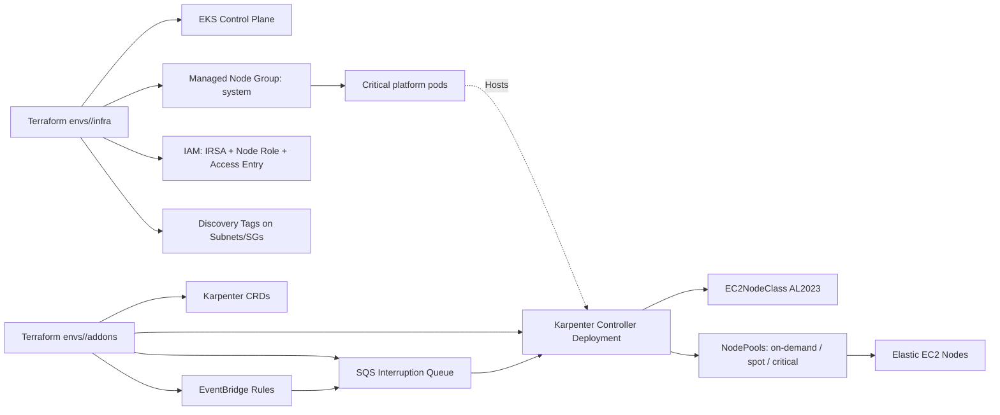

# Architecture Overview

This solution deploys Amazon EKS and Karpenter with a **two-stack model**:

1. `infra` stack: EKS, fixed managed node group, IAM (IRSA + node role), network discovery tags.
2. `addons` stack: Karpenter Helm chart, CRDs, SQS + EventBridge interruption handling.

## High-level design

## Capacity strategy

- **Fixed baseline**: managed node group (`system`) keeps cluster-critical components stable.
- **Elastic pool**: Karpenter NodePools for workload scaling.
- **Segmentation**:
  - `critical-ondemand`: tainted on-demand only for sensitive workloads.
  - `ondemand-general`: steady non-critical production workloads.
  - `spot-flexible`: flexible/stateless workloads with Spot economics.

## Security model

- IRSA for controller (no static credentials in pods).
- Least-privilege policy with tag-based scope for mutating EC2 APIs.
- EKS Access Entry for Karpenter nodes (`EC2_LINUX`) instead of legacy `aws-auth` dependency.
- Encrypted SQS queues (`sqs_managed_sse_enabled = true`).
- IMDSv2 enforced for Karpenter-managed nodes.

## Private cluster notes

For private-only EKS API (`cluster_endpoint_public_access = false`), ensure the VPC has:

- ECR API + ECR DKR VPC endpoints
- STS VPC endpoint
- SSM endpoint (if AMI lookups and SSM access are needed privately)
- CloudWatch Logs endpoint (if needed by your logging stack)
- Optional: NAT or VPC endpoints for additional external dependencies

If no internet egress exists, validate Karpenter image pulls and AWS API reachability via VPC endpoints before production cutover.