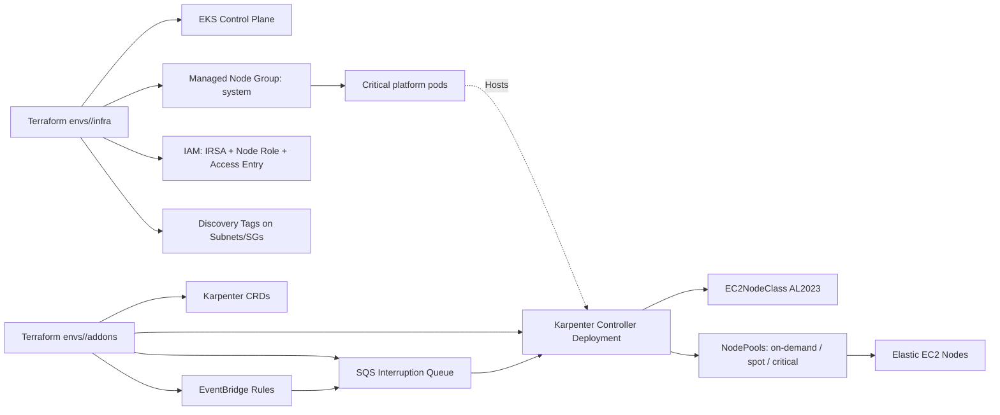

# Project File Dump

Generated snapshot of all repository files.

## .gitignore

`$ext
# Terraform
**/.terraform/*
**/terraform.tfstate
**/terraform.tfstate.*
**/crash.log
**/*.tfvars
!**/*.tfvars.example

# Local kubeconfig
kubeconfig

# Rendered manifests
manifests/rendered/*
!manifests/rendered/.gitkeep

```

## docs\architecture.md

`$ext
# Architecture Overview

This solution deploys Amazon EKS and Karpenter with a **two-stack model**:

1. `infra` stack: EKS, fixed managed node group, IAM (IRSA + node role), network discovery tags.
2. `addons` stack: Karpenter Helm chart, CRDs, SQS + EventBridge interruption handling.

## High-level design



## Capacity strategy

- **Fixed baseline**: managed node group (`system`) keeps cluster-critical components stable.
- **Elastic pool**: Karpenter NodePools for workload scaling.
- **Segmentation**:
  - `critical-ondemand`: tainted on-demand only for sensitive workloads.
  - `ondemand-general`: steady non-critical production workloads.
  - `spot-flexible`: flexible/stateless workloads with Spot economics.

## Security model

- IRSA for controller (no static credentials in pods).
- Least-privilege policy with tag-based scope for mutating EC2 APIs.
- EKS Access Entry for Karpenter nodes (`EC2_LINUX`) instead of legacy `aws-auth` dependency.
- Encrypted SQS queues (`sqs_managed_sse_enabled = true`).
- IMDSv2 enforced for Karpenter-managed nodes.

## Private cluster notes

For private-only EKS API (`cluster_endpoint_public_access = false`), ensure the VPC has:

- ECR API + ECR DKR VPC endpoints
- STS VPC endpoint
- SSM endpoint (if AMI lookups and SSM access are needed privately)
- CloudWatch Logs endpoint (if needed by your logging stack)
- Optional: NAT or VPC endpoints for additional external dependencies

If no internet egress exists, validate Karpenter image pulls and AWS API reachability via VPC endpoints before production cutover.
```

## docs\costs-and-capacity.md

`$ext
# Costs and Capacity Strategy

## Strategy implemented

- Fixed managed node group for core services (predictable baseline cost).
- Karpenter NodePools for burst and flexible demand.
- Spot pool (`spot-flexible`) for stateless and retry-friendly workloads.
- On-demand critical pool with strict taints for sensitive services.

## Cost controls

- NodePool `limits` cap total provisioned CPU/memory.
- Consolidation enabled to reduce idle/fragmented nodes.
- `expireAfter` forces periodic node recycling and prevents long-lived drift.
- Instance constraints avoid legacy/inefficient families.

## Recommended workload placement

- Critical APIs/stateful gateways: `critical-ondemand`.
- Core production stateless services: `ondemand-general`.
- Batch/async/CI workers: `spot-flexible` with tolerations.

## Example selectors/tolerations

```yaml
nodeSelector:
  capacity-tier: spot
tolerations:
  - key: spot-only
    operator: Equal
    value: "true"
    effect: NoSchedule
```

```yaml
nodeSelector:
  workload-tier: critical
tolerations:
  - key: critical-only
    operator: Equal
    value: "true"
    effect: NoSchedule
```

## Instance family governance

Current templates enforce:

- Allowed categories/families/generation/hypervisor
- Spot pool graviton-first (`arm64`) for better price/perf
- Critical pool x86-focused for compatibility-sensitive workloads

Adjust these in `manifests/templates/nodepool-*.yaml.tpl`.
```

## docs\decisions.md

`$ext
# Architectural Decisions

## Why two Terraform stacks per environment

We split into `infra` and `addons` to avoid bootstrap dependency issues with Kubernetes/Helm providers before the EKS API exists, and to support safer release cadence for platform add-ons.

## Why Access Entries instead of aws-auth

`aws_eks_access_entry` is the modern AWS-managed approach and avoids direct manual management of `aws-auth` ConfigMap for worker node access.

## Why fixed managed node group + Karpenter

- Managed node group provides stable control-plane-adjacent capacity.
- Karpenter provides elastic and cost-efficient scheduling for workloads.
- This prevents controller self-hosting loops and startup deadlocks.

## Why AL2023 and pinned versions

AL2023 provides current hardening and lifecycle posture. AMI alias and chart/Kubernetes versions are pinned and parameterized to avoid uncontrolled drift.

# Trade-offs

- Two-stack deployment is more steps than single stack, but significantly more reliable.
- Using templates + render script for NodePools adds one manifest generation step, but improves GitOps portability and reviewability.
- Restrictive instance requirements improve governance but can reduce immediate capacity options in constrained AZs.

# Future Improvements

1. Add CI pipeline (`terraform fmt`, `validate`, `tflint`, `tfsec`, `kubeconform`).
2. Add OPA/Conftest policy checks for NodePool constraints.
3. Add Argo CD Application manifests for GitOps promotion.
4. Add dedicated NodePool per workload domain/team.
5. Add FinOps dashboards with Karpenter + EC2 cost attribution.

# Common Errors and How to Avoid Them

1. **Controller running on Karpenter nodes**
Set managed node group selector in Helm values and keep baseline capacity.

2. **Using unpinned versions**
Always set explicit versions for Kubernetes, add-ons, Karpenter chart, and AMI alias.

3. **Forgetting discovery tags**
Ensure subnets and security groups have `karpenter.sh/discovery=<cluster-name>`.

4. **Mixing incompatible workload constraints**
If workload selectors/taints do not match NodePool labels/taints, pods remain pending.

5. **No interruption handling for Spot**
Always keep SQS + EventBridge enabled when using Spot NodePools.
```

## docs\deployment-guide.md

`$ext
# Deployment Guide

## Prerequisites

- Terraform `>= 1.8.5`
- AWS CLI v2 authenticated (do not use `--profile`; rely on environment/SSO/default credentials)
- `kubectl`
- `helm` v3
- Access to:
  - Existing VPC and private subnets
  - S3 bucket + DynamoDB table for Terraform state
  - IAM permissions to create EKS, IAM, EC2 tags, SQS, EventBridge

## Step 1: Prepare environment files

For the selected environment (`dev`, `stage`, `prod`):

1. Copy examples to active tfvars:

```powershell
Copy-Item envs/dev/infra/terraform.tfvars.example envs/dev/infra/terraform.tfvars
Copy-Item envs/dev/addons/terraform.tfvars.example envs/dev/addons/terraform.tfvars
```

2. Update values:
- VPC and subnet IDs
- backend state parameters (`terraform init -backend-config=...`)
- versions/tags/capacity limits

## Step 2: Deploy infra stack

```powershell
terraform -chdir=envs/dev/infra init -backend-config="bucket=<state-bucket>" -backend-config="key=karpenter/dev/infra/terraform.tfstate" -backend-config="region=us-east-1" -backend-config="dynamodb_table=<lock-table>"
terraform -chdir=envs/dev/infra plan
terraform -chdir=envs/dev/infra apply
```

## Step 3: Deploy addons stack (Karpenter + interruptions)

```powershell
terraform -chdir=envs/dev/addons init -backend-config="bucket=<state-bucket>" -backend-config="key=karpenter/dev/addons/terraform.tfstate" -backend-config="region=us-east-1" -backend-config="dynamodb_table=<lock-table>"
terraform -chdir=envs/dev/addons plan
terraform -chdir=envs/dev/addons apply
```

## Step 4: Configure kubeconfig

```powershell
$cluster = terraform -chdir=envs/dev/infra output -raw cluster_name
$region  = terraform -chdir=envs/dev/infra output -raw aws_region
aws eks update-kubeconfig --name $cluster --region $region
```

## Step 5: Render and apply NodeClass/NodePools

```powershell
./scripts/render-manifests.ps1 -Environment dev -UseTerraformOutputs
kubectl apply -f manifests/rendered/dev
```

## Step 6: Optional smoke tests

```powershell
./scripts/smoke-test.ps1
```

## One-command helper

```powershell
./scripts/deploy.ps1 -Environment dev
```

## Post-deploy validation

```powershell
./scripts/validate.ps1 -Environment dev
```
```

## docs\file-reference.md

`$ext
# File Reference

## Root

- `.gitignore`: ignores state files and rendered artifacts.
- `README.md`: consolidated guide, architecture summary, command order, checklist.

## Modules

- `modules/eks/versions.tf`: provider/version constraints for EKS module.
- `modules/eks/variables.tf`: input contract for cluster and node group settings.
- `modules/eks/main.tf`: EKS cluster, managed node group, OIDC, addons, tags.
- `modules/eks/outputs.tf`: exports cluster IDs/endpoints/certs/SG IDs.

- `modules/network/versions.tf`: provider/version constraints.
- `modules/network/variables.tf`: subnet/SG discovery tagging inputs.
- `modules/network/main.tf`: tags private subnets and security groups for Karpenter discovery.
- `modules/network/outputs.tf`: exports tagged resources.

- `modules/iam/versions.tf`: provider/version constraints.
- `modules/iam/variables.tf`: IAM input contract (IRSA, node role, queue name, boundaries).
- `modules/iam/main.tf`: IRSA role/policy, node role/profile, access entry.
- `modules/iam/outputs.tf`: exports role/profile/policy/access entry IDs.

- `modules/karpenter/versions.tf`: provider constraints for AWS/Helm/Kubernetes.
- `modules/karpenter/variables.tf`: chart/queue/controller config inputs.
- `modules/karpenter/main.tf`: SQS/EventBridge + Helm install (CRDs + controller).
- `modules/karpenter/outputs.tf`: exports release and interruption infrastructure outputs.

## Environments

Each environment has two stacks:

- `envs/<env>/infra/*`: EKS + IAM + discovery tags.
- `envs/<env>/addons/*`: Karpenter Helm + interruption handling.

For each stack:

- `backend.tf`: backend declaration (`s3`).
- `versions.tf`: Terraform/provider version constraints.
- `providers.tf`: provider configuration.
- `variables.tf`: validated inputs.
- `main.tf`: module composition.
- `outputs.tf`: consumable outputs.
- `terraform.tfvars.example`: practical pinned example values.

## Helm values

- `helm-values/karpenter-values-dev.yaml`: dev tuning.
- `helm-values/karpenter-values-stage.yaml`: stage tuning.
- `helm-values/karpenter-values-prod.yaml`: production tuning.

## Manifests

- `manifests/templates/ec2nodeclass-al2023.yaml.tpl`: AL2023 node class with tags/disks/IMDSv2.
- `manifests/templates/nodepool-ondemand.yaml.tpl`: general on-demand node pool.
- `manifests/templates/nodepool-spot.yaml.tpl`: Spot graviton-focused node pool.
- `manifests/templates/nodepool-critical.yaml.tpl`: tainted critical on-demand node pool.

- `manifests/env/*.env`: environment-specific values used in template rendering.
- `manifests/workloads/*.yaml`: sample workloads for scale and placement tests.
- `manifests/observability/karpenter-alert-rules.yaml`: sample Prometheus alerts.
- `manifests/README.md`: render/apply instructions.

## Scripts

- `scripts/render-manifests.ps1`: renders templates to `manifests/rendered/<env>`.
- `scripts/deploy.ps1`: end-to-end deploy helper.
- `scripts/validate.ps1`: post-deploy checks.
- `scripts/smoke-test.ps1`: load/placement test workloads.

## Docs

- `docs/architecture.md`: architecture and flow.
- `docs/deployment-guide.md`: deployment steps in order.
- `docs/operations.md`: metrics/logs/alerting/ops checks.
- `docs/upgrade-rollback.md`: upgrade and rollback procedures.
- `docs/costs-and-capacity.md`: capacity and cost controls.
- `docs/troubleshooting.md`: failure scenarios and remediations.
- `docs/decisions.md`: decisions, trade-offs, future improvements, common errors.
- `docs/file-reference.md`: this file.
- `docs/project-dump.md`: complete file-by-file content dump of the repository.

```

## docs\operations.md

`$ext
# Operations and Observability

## Metrics and scraping

- Helm values enable `serviceMonitor.enabled=true`.
- Integrate with `kube-prometheus-stack` by keeping label `release: kube-prometheus-stack`.

## Logs

Controller logs:

```powershell
kubectl logs -n karpenter deployment/karpenter -f
```

Increase verbosity temporarily by changing `controller_log_level` to `debug` in `envs/<env>/addons/terraform.tfvars` and re-applying addons stack.

## Recommended alerts

Apply the sample rule file:

```powershell
kubectl apply -f manifests/observability/karpenter-alert-rules.yaml
```

It includes:
- Controller unavailable
- High reconcile error rate
- Excessive unschedulable pods

## Daily operational checks

```powershell
kubectl get nodepools
kubectl get ec2nodeclasses
kubectl get nodes -L karpenter.sh/nodepool,karpenter.sh/capacity-type
kubectl get pods -n karpenter -o wide
```

## Spot interruption flow

1. EventBridge captures interruption/rebalance/maintenance/state-change events.
2. Events are pushed to SQS queue.
3. Karpenter controller consumes queue messages.
4. Node disruption is coordinated by Karpenter disruption logic and pod scheduling.

## Troubleshooting quick commands

```powershell
kubectl describe nodepool spot-flexible
kubectl describe ec2nodeclass default-al2023
kubectl get events -A --sort-by=.lastTimestamp | Select-Object -Last 40
aws events list-rules --name-prefix <cluster>-karpenter --region <region>
aws sqs get-queue-url --queue-name <cluster>-karpenter-interruptions --region <region>
```

## Post-deploy checklist

- Karpenter pods running on managed node group (`system`), not Karpenter nodes.
- EC2NodeClass Ready.
- All expected NodePools Ready.
- Scale-up observed from sample workloads.
- Scale-down/consolidation observed after workload removal.
- SQS queue receives interruption events (or at least queue/rules are healthy).
- Alert rules loaded in Prometheus.
```

## docs\troubleshooting.md

`$ext
# Troubleshooting

## Karpenter pod not scheduling

Checks:

```powershell
kubectl get pods -n karpenter -o wide
kubectl describe pod -n karpenter <pod-name>
kubectl get nodes -L eks.amazonaws.com/nodegroup
```

Fixes:

- Confirm `system_node_group_name` matches actual managed node group label.
- Ensure fixed node group has enough headroom.

## NodePool exists but no nodes are created

Checks:

```powershell
kubectl describe nodepool ondemand-general
kubectl describe ec2nodeclass default-al2023
kubectl logs -n karpenter deployment/karpenter --tail=200
```

Common causes:

- Missing discovery tags on subnets/security groups.
- AMI alias invalid for region.
- EC2 quota/instance availability constraints.
- IAM policy missing `iam:PassRole` or EC2 permissions.

## Nodes fail to join cluster

Checks:

```powershell
aws eks list-access-entries --cluster-name <cluster> --region <region>
```

Fixes:

- Confirm `aws_eks_access_entry` exists for Karpenter node role.
- Validate instance profile and node role policies.

## Spot interruption queue not receiving events

Checks:

```powershell
aws events list-rule-names-by-target --target-arn <queue-arn> --region <region>
aws sqs get-queue-attributes --queue-url <queue-url> --attribute-names All --region <region>
```

Fixes:

- Confirm EventBridge rules are enabled.
- Confirm SQS queue policy allows `events.amazonaws.com` with source rule ARNs.

## Helm release failed

Checks:

```powershell
helm list -n karpenter
helm status karpenter -n karpenter
kubectl get events -n karpenter --sort-by=.lastTimestamp
```

Fixes:

- Validate OIDC/IRSA role annotation.
- Validate chart version exists in OCI registry.
- Re-apply addons stack after fixing values.
```

## docs\upgrade-rollback.md

`$ext
# Upgrade and Rollback

## Karpenter upgrade

1. Review release notes for the target version.
2. Update `karpenter_version` in `envs/<env>/addons/terraform.tfvars`.
3. Run:

```powershell
terraform -chdir=envs/<env>/addons plan
terraform -chdir=envs/<env>/addons apply
```

4. Validate:

```powershell
kubectl get pods -n karpenter
kubectl get crd | Select-String karpenter
```

## Kubernetes/EKS upgrade

1. Upgrade one environment at a time (`dev -> stage -> prod`).
2. Update `kubernetes_version` in `envs/<env>/infra/terraform.tfvars`.
3. Confirm compatible addon versions in `addon_versions`.
4. Apply infra stack and monitor node group rollouts.

## NodePool tuning rollout

- Update template values in `manifests/env/<env>.env`.
- Re-render and apply manifests:

```powershell
./scripts/render-manifests.ps1 -Environment <env> -UseTerraformOutputs
kubectl apply -f manifests/rendered/<env>
```

## Rollback strategy

### Karpenter rollback

- Revert `karpenter_version` to the previous tested version.
- Re-apply `envs/<env>/addons`.

### NodePool rollback

- Revert manifest templates/environment values in Git.
- Re-render and apply prior manifests.

### EKS rollback

Control plane downgrade is not supported in-place. For major incidents:

- Keep managed baseline capacity healthy.
- Revert addon/NodePool changes first.
- If needed, perform blue/green cluster recovery strategy.

## Safe deployment guidance

- Always test upgrades in `dev` and `stage` before `prod`.
- Keep managed node group capacity sufficient during changes.
- Avoid simultaneous EKS + Karpenter + NodePool disruptive changes in one window.
```

## envs\dev\addons\backend.tf

`$ext
terraform {
  backend "s3" {}
}
```

## envs\dev\addons\main.tf

`$ext
locals {
  environment = "dev"

  common_tags = merge(
    var.default_tags,
    {
      Environment   = local.environment
      TerraformRoot = "envs/dev/addons"
      Component     = "karpenter"
    }
  )

  effective_helm_values_path = coalesce(
    var.helm_values_path,
    "${path.root}/../../../helm-values/karpenter-values-dev.yaml"
  )
}

data "terraform_remote_state" "infra" {
  backend = "s3"

  config = merge(
    {
      bucket = var.infra_state_bucket
      key    = var.infra_state_key
      region = var.infra_state_region
    },
    var.infra_state_lock_table == null ? {} : { dynamodb_table = var.infra_state_lock_table }
  )
}

module "karpenter" {
  source = "../../../modules/karpenter"

  environment                      = local.environment
  cluster_name                     = data.terraform_remote_state.infra.outputs.cluster_name
  cluster_endpoint                 = data.terraform_remote_state.infra.outputs.cluster_endpoint
  karpenter_namespace              = var.karpenter_namespace
  karpenter_version                = var.karpenter_version
  controller_role_arn              = data.terraform_remote_state.infra.outputs.karpenter_controller_role_arn
  system_node_group_name           = data.terraform_remote_state.infra.outputs.system_node_group_name
  helm_values_path                 = local.effective_helm_values_path
  controller_replicas              = var.controller_replicas
  controller_log_level             = var.controller_log_level
  enable_spot_interruption_handling = var.enable_spot_interruption_handling
  interruption_queue_name          = data.terraform_remote_state.infra.outputs.karpenter_interruption_queue_name
  tags                             = local.common_tags
}

```

## envs\dev\addons\outputs.tf

`$ext
output "environment" {
  description = "Environment name."
  value       = local.environment
}

output "karpenter_namespace" {
  description = "Namespace where Karpenter was installed."
  value       = module.karpenter.karpenter_namespace
}

output "karpenter_helm_release" {
  description = "Helm release name for Karpenter controller."
  value       = module.karpenter.helm_release_name
}

output "interruption_queue_name" {
  description = "SQS queue receiving interruption events."
  value       = module.karpenter.interruption_queue_name
}

output "interruption_queue_arn" {
  description = "SQS queue ARN receiving interruption events."
  value       = module.karpenter.interruption_queue_arn
}

output "interruption_event_rule_arns" {
  description = "EventBridge rules that send interruption events to SQS."
  value       = module.karpenter.interruption_event_rule_arns
}
```

## envs\dev\addons\providers.tf

`$ext
provider "aws" {
  region = var.aws_region

  default_tags {
    tags = local.common_tags
  }
}

data "aws_eks_cluster" "this" {
  name = data.terraform_remote_state.infra.outputs.cluster_name
}

data "aws_eks_cluster_auth" "this" {
  name = data.terraform_remote_state.infra.outputs.cluster_name
}

provider "kubernetes" {
  host                   = data.aws_eks_cluster.this.endpoint
  cluster_ca_certificate = base64decode(data.aws_eks_cluster.this.certificate_authority[0].data)
  token                  = data.aws_eks_cluster_auth.this.token
}

provider "helm" {
  kubernetes {
    host                   = data.aws_eks_cluster.this.endpoint
    cluster_ca_certificate = base64decode(data.aws_eks_cluster.this.certificate_authority[0].data)
    token                  = data.aws_eks_cluster_auth.this.token
  }
}
```

## envs\dev\addons\terraform.tfvars.example

`$ext
aws_region = "us-east-1"

infra_state_bucket = "org-terraform-states"
infra_state_key    = "karpenter/dev/infra/terraform.tfstate"
infra_state_region = "us-east-1"

karpenter_namespace               = "karpenter"
karpenter_version                 = "1.8.2"
controller_replicas               = 2
controller_log_level              = "info"
enable_spot_interruption_handling = true

# Optional override if you want a custom values file.
# helm_values_path = "C:/path/to/helm-values/karpenter-values-dev.yaml"

default_tags = {
  Project    = "platform"
  ManagedBy  = "terraform"
  Owner      = "platform-team"
  CostCenter = "cc-1000"
  Compliance = "internal"
}
```

## envs\dev\addons\variables.tf

`$ext
variable "aws_region" {
  description = "AWS region for this environment."
  type        = string
}

variable "infra_state_bucket" {
  description = "S3 bucket containing infra stack state."
  type        = string
}

variable "infra_state_key" {
  description = "S3 key for infra stack state file."
  type        = string
}

variable "infra_state_region" {
  description = "AWS region of the infra state S3 bucket."
  type        = string
}

variable "infra_state_lock_table" {
  description = "Optional DynamoDB table used by infra stack state locking."
  type        = string
  default     = null
}

variable "karpenter_namespace" {
  description = "Namespace for Karpenter controller."
  type        = string
  default     = "karpenter"
}

variable "karpenter_version" {
  description = "Pinned Karpenter Helm chart version."
  type        = string
  default     = "1.8.2"
}

variable "controller_replicas" {
  description = "Number of Karpenter controller replicas."
  type        = number
  default     = 2
}

variable "controller_log_level" {
  description = "Controller log level."
  type        = string
  default     = "info"
}

variable "enable_spot_interruption_handling" {
  description = "Create EventBridge and SQS resources for interruption handling."
  type        = bool
  default     = true
}

variable "helm_values_path" {
  description = "Optional absolute or relative path to Karpenter Helm values file."
  type        = string
  default     = null
}

variable "default_tags" {
  description = "Mandatory standard tags for governance and cost allocation."
  type        = map(string)

  validation {
    condition = alltrue([
      for required_key in ["Project", "ManagedBy", "Owner", "CostCenter"] :
      contains(keys(var.default_tags), required_key)
    ])
    error_message = "default_tags must include Project, ManagedBy, Owner and CostCenter."
  }
}
```

## envs\dev\addons\versions.tf

`$ext
terraform {
  required_version = ">= 1.8.5"

  required_providers {
    aws = {
      source  = "hashicorp/aws"
      version = "~> 5.95"
    }
    helm = {
      source  = "hashicorp/helm"
      version = "~> 2.14"
    }
    kubernetes = {
      source  = "hashicorp/kubernetes"
      version = "~> 2.35"
    }
  }
}
```

## envs\dev\infra\backend.tf

`$ext
terraform {
  backend "s3" {}
}
```

## envs\dev\infra\main.tf

`$ext
locals {
  environment = "dev"

  karpenter_interruption_queue_name = coalesce(
    var.karpenter_interruption_queue_name,
    "${var.cluster_name}-karpenter-interruptions"
  )

  common_tags = merge(
    var.default_tags,
    {
      Environment   = local.environment
      TerraformRoot = "envs/dev/infra"
      Component     = "eks-karpenter"
    }
  )
}

module "eks" {
  source = "../../../modules/eks"

  cluster_name                             = var.cluster_name
  kubernetes_version                       = var.kubernetes_version
  vpc_id                                   = var.vpc_id
  private_subnet_ids                       = var.private_subnet_ids
  cluster_endpoint_private_access          = var.cluster_endpoint_private_access
  cluster_endpoint_public_access           = var.cluster_endpoint_public_access
  authentication_mode                      = var.authentication_mode
  enable_cluster_creator_admin_permissions = var.enable_cluster_creator_admin_permissions
  addon_versions                           = var.addon_versions
  system_node_group                        = var.system_node_group
  tags                                     = local.common_tags
}

module "network" {
  source = "../../../modules/network"

  cluster_name                  = var.cluster_name
  private_subnet_ids            = var.private_subnet_ids
  discovery_security_group_ids  = [module.eks.node_security_group_id, module.eks.cluster_primary_security_group_id]
  tag_subnets_for_karpenter     = true
  tag_security_groups_for_karpenter = true
}

module "iam" {
  source = "../../../modules/iam"

  aws_region                     = var.aws_region
  cluster_name                   = var.cluster_name
  cluster_arn                    = module.eks.cluster_arn
  oidc_provider_arn              = module.eks.oidc_provider_arn
  oidc_provider_url              = module.eks.cluster_oidc_issuer_url
  karpenter_namespace            = var.karpenter_namespace
  karpenter_service_account_name = var.karpenter_service_account_name
  interruption_queue_name        = local.karpenter_interruption_queue_name
  permissions_boundary_arn       = var.permissions_boundary_arn
  create_node_access_entry       = true
  tags                           = local.common_tags
}
```

## envs\dev\infra\outputs.tf

`$ext
output "environment" {
  description = "Environment name."
  value       = local.environment
}

output "aws_region" {
  description = "AWS region used by this stack."
  value       = var.aws_region
}

output "cluster_name" {
  description = "EKS cluster name."
  value       = module.eks.cluster_name
}

output "cluster_arn" {
  description = "EKS cluster ARN."
  value       = module.eks.cluster_arn
}

output "cluster_endpoint" {
  description = "EKS API endpoint used by kubectl/helm."
  value       = module.eks.cluster_endpoint
}

output "cluster_certificate_authority_data" {
  description = "EKS cluster CA data for kubeconfig generation."
  value       = module.eks.cluster_certificate_authority_data
  sensitive   = true
}

output "oidc_provider_arn" {
  description = "OIDC provider ARN for IRSA integrations."
  value       = module.eks.oidc_provider_arn
}

output "oidc_provider_url" {
  description = "OIDC issuer URL for IRSA trust policy construction."
  value       = module.eks.cluster_oidc_issuer_url
}

output "system_node_group_name" {
  description = "Managed node group name reserved for critical components."
  value       = module.eks.system_node_group_name
}

output "node_security_group_id" {
  description = "Shared node security group ID tagged for Karpenter discovery."
  value       = module.eks.node_security_group_id
}

output "karpenter_controller_role_arn" {
  description = "IRSA role ARN for Karpenter controller service account."
  value       = module.iam.controller_role_arn
}

output "karpenter_node_role_arn" {
  description = "Node IAM role ARN used by instances launched by Karpenter."
  value       = module.iam.node_role_arn
}

output "karpenter_node_instance_profile_name" {
  description = "EC2 instance profile name referenced by EC2NodeClass."
  value       = module.iam.node_instance_profile_name
}

output "karpenter_interruption_queue_name" {
  description = "Queue name expected by IAM policy and addons stack."
  value       = local.karpenter_interruption_queue_name
}
```

## envs\dev\infra\providers.tf

`$ext
provider "aws" {
  region = var.aws_region

  default_tags {
    tags = local.common_tags
  }
}
```

## envs\dev\infra\terraform.tfvars.example

`$ext
aws_region         = "us-east-1"
cluster_name       = "eks-karpenter-dev"
kubernetes_version = "1.30"

vpc_id = "vpc-0123456789abcdef0"
private_subnet_ids = [
  "subnet-0aaaa1111bbbb2222",
  "subnet-03333cccc4444dddd",
  "subnet-05555eeee6666ffff"
]

cluster_endpoint_private_access = true
cluster_endpoint_public_access  = false
authentication_mode             = "API"

default_tags = {
  Project    = "platform"
  ManagedBy  = "terraform"
  Owner      = "platform-team"
  CostCenter = "cc-1000"
  Compliance = "internal"
}

addon_versions = {
  coredns            = "v1.11.4-eksbuild.24"
  kube_proxy         = "v1.30.10-eksbuild.7"
  vpc_cni            = "v1.19.0-eksbuild.1"
  pod_identity_agent = "v1.3.8-eksbuild.1"
}

system_node_group = {
  name            = "system"
  desired_size    = 2
  min_size        = 2
  max_size        = 3
  instance_types  = ["m6i.large"]
  ami_type        = "AL2023_x86_64_STANDARD"
  disk_size       = 80
  capacity_type   = "ON_DEMAND"
  max_unavailable = 1
  labels = {
    "node-role.kubernetes.io/system" = "true"
    "workload-tier"                  = "core"
  }
}

karpenter_namespace            = "karpenter"
karpenter_service_account_name = "karpenter"

# Optional: set only if your organization enforces IAM boundaries.
# permissions_boundary_arn = "arn:aws:iam::123456789012:policy/permissions-boundary"
```

## envs\dev\infra\variables.tf

`$ext
variable "aws_region" {
  description = "AWS region for this environment."
  type        = string
}

variable "cluster_name" {
  description = "EKS cluster name for this environment."
  type        = string
}

variable "kubernetes_version" {
  description = "Pinned Kubernetes version for EKS cluster."
  type        = string
}

variable "vpc_id" {
  description = "Existing VPC ID used by the cluster."
  type        = string
}

variable "private_subnet_ids" {
  description = "Private subnets where EKS and Karpenter nodes will run."
  type        = list(string)
}

variable "cluster_endpoint_private_access" {
  description = "Enable private endpoint for EKS API."
  type        = bool
  default     = true
}

variable "cluster_endpoint_public_access" {
  description = "Enable public endpoint for EKS API."
  type        = bool
  default     = false
}

variable "authentication_mode" {
  description = "EKS authentication mode. API mode uses access entries and avoids aws-auth dependency."
  type        = string
  default     = "API"
}

variable "enable_cluster_creator_admin_permissions" {
  description = "Temporarily grants admin to the identity creating the cluster."
  type        = bool
  default     = true
}

variable "addon_versions" {
  description = "Pinned addon versions for CoreDNS, kube-proxy, VPC CNI and pod identity agent."
  type = object({
    coredns            = string
    kube_proxy         = string
    vpc_cni            = string
    pod_identity_agent = string
  })
}

variable "system_node_group" {
  description = "Managed node group that hosts core platform components."
  type = object({
    name            = string
    desired_size    = number
    min_size        = number
    max_size        = number
    instance_types  = list(string)
    ami_type        = string
    disk_size       = number
    capacity_type   = string
    max_unavailable = number
    labels          = map(string)
  })
}

variable "karpenter_namespace" {
  description = "Namespace for Karpenter controller service account."
  type        = string
  default     = "karpenter"
}

variable "karpenter_service_account_name" {
  description = "Service account name for Karpenter controller."
  type        = string
  default     = "karpenter"
}

variable "karpenter_interruption_queue_name" {
  description = "Optional queue name override for interruption handling permissions."
  type        = string
  default     = null
}

variable "permissions_boundary_arn" {
  description = "Optional IAM permissions boundary for enterprise controls."
  type        = string
  default     = null
}

variable "default_tags" {
  description = "Mandatory standard tags for governance and cost allocation."
  type        = map(string)

  validation {
    condition = alltrue([
      for required_key in ["Project", "ManagedBy", "Owner", "CostCenter"] :
      contains(keys(var.default_tags), required_key)
    ])
    error_message = "default_tags must include Project, ManagedBy, Owner and CostCenter."
  }
}
```

## envs\dev\infra\versions.tf

`$ext
terraform {
  required_version = ">= 1.8.5"

  required_providers {
    aws = {
      source  = "hashicorp/aws"
      version = "~> 5.95"
    }
  }
}
```

## envs\prod\addons\backend.tf

`$ext
terraform {
  backend "s3" {}
}
```

## envs\prod\addons\main.tf

`$ext
locals {
  environment = "prod"

  common_tags = merge(
    var.default_tags,
    {
      Environment   = local.environment
      TerraformRoot = "envs/prod/addons"
      Component     = "karpenter"
    }
  )

  effective_helm_values_path = coalesce(
    var.helm_values_path,
    "${path.root}/../../../helm-values/karpenter-values-prod.yaml"
  )
}

data "terraform_remote_state" "infra" {
  backend = "s3"

  config = merge(
    {
      bucket = var.infra_state_bucket
      key    = var.infra_state_key
      region = var.infra_state_region
    },
    var.infra_state_lock_table == null ? {} : { dynamodb_table = var.infra_state_lock_table }
  )
}

module "karpenter" {
  source = "../../../modules/karpenter"

  environment                      = local.environment
  cluster_name                     = data.terraform_remote_state.infra.outputs.cluster_name
  cluster_endpoint                 = data.terraform_remote_state.infra.outputs.cluster_endpoint
  karpenter_namespace              = var.karpenter_namespace
  karpenter_version                = var.karpenter_version
  controller_role_arn              = data.terraform_remote_state.infra.outputs.karpenter_controller_role_arn
  system_node_group_name           = data.terraform_remote_state.infra.outputs.system_node_group_name
  helm_values_path                 = local.effective_helm_values_path
  controller_replicas              = var.controller_replicas
  controller_log_level             = var.controller_log_level
  enable_spot_interruption_handling = var.enable_spot_interruption_handling
  interruption_queue_name          = data.terraform_remote_state.infra.outputs.karpenter_interruption_queue_name
  tags                             = local.common_tags
}

```

## envs\prod\addons\outputs.tf

`$ext
output "environment" {
  description = "Environment name."
  value       = local.environment
}

output "karpenter_namespace" {
  description = "Namespace where Karpenter was installed."
  value       = module.karpenter.karpenter_namespace
}

output "karpenter_helm_release" {
  description = "Helm release name for Karpenter controller."
  value       = module.karpenter.helm_release_name
}

output "interruption_queue_name" {
  description = "SQS queue receiving interruption events."
  value       = module.karpenter.interruption_queue_name
}

output "interruption_queue_arn" {
  description = "SQS queue ARN receiving interruption events."
  value       = module.karpenter.interruption_queue_arn
}

output "interruption_event_rule_arns" {
  description = "EventBridge rules that send interruption events to SQS."
  value       = module.karpenter.interruption_event_rule_arns
}
```

## envs\prod\addons\providers.tf

`$ext
provider "aws" {
  region = var.aws_region

  default_tags {
    tags = local.common_tags
  }
}

data "aws_eks_cluster" "this" {
  name = data.terraform_remote_state.infra.outputs.cluster_name
}

data "aws_eks_cluster_auth" "this" {
  name = data.terraform_remote_state.infra.outputs.cluster_name
}

provider "kubernetes" {
  host                   = data.aws_eks_cluster.this.endpoint
  cluster_ca_certificate = base64decode(data.aws_eks_cluster.this.certificate_authority[0].data)
  token                  = data.aws_eks_cluster_auth.this.token
}

provider "helm" {
  kubernetes {
    host                   = data.aws_eks_cluster.this.endpoint
    cluster_ca_certificate = base64decode(data.aws_eks_cluster.this.certificate_authority[0].data)
    token                  = data.aws_eks_cluster_auth.this.token
  }
}
```

## envs\prod\addons\terraform.tfvars.example

`$ext
aws_region = "us-east-1"

infra_state_bucket = "org-terraform-states"
infra_state_key    = "karpenter/prod/infra/terraform.tfstate"
infra_state_region = "us-east-1"

karpenter_namespace               = "karpenter"
karpenter_version                 = "1.8.2"
controller_replicas               = 3
controller_log_level              = "warn"
enable_spot_interruption_handling = true

# Optional override if you want a custom values file.
# helm_values_path = "C:/path/to/helm-values/karpenter-values-prod.yaml"

default_tags = {
  Project    = "platform"
  ManagedBy  = "terraform"
  Owner      = "platform-team"
  CostCenter = "cc-1000"
  Compliance = "internal"
}

```

## envs\prod\addons\variables.tf

`$ext
variable "aws_region" {
  description = "AWS region for this environment."
  type        = string
}

variable "infra_state_bucket" {
  description = "S3 bucket containing infra stack state."
  type        = string
}

variable "infra_state_key" {
  description = "S3 key for infra stack state file."
  type        = string
}

variable "infra_state_region" {
  description = "AWS region of the infra state S3 bucket."
  type        = string
}

variable "infra_state_lock_table" {
  description = "Optional DynamoDB table used by infra stack state locking."
  type        = string
  default     = null
}

variable "karpenter_namespace" {
  description = "Namespace for Karpenter controller."
  type        = string
  default     = "karpenter"
}

variable "karpenter_version" {
  description = "Pinned Karpenter Helm chart version."
  type        = string
  default     = "1.8.2"
}

variable "controller_replicas" {
  description = "Number of Karpenter controller replicas."
  type        = number
  default     = 2
}

variable "controller_log_level" {
  description = "Controller log level."
  type        = string
  default     = "info"
}

variable "enable_spot_interruption_handling" {
  description = "Create EventBridge and SQS resources for interruption handling."
  type        = bool
  default     = true
}

variable "helm_values_path" {
  description = "Optional absolute or relative path to Karpenter Helm values file."
  type        = string
  default     = null
}

variable "default_tags" {
  description = "Mandatory standard tags for governance and cost allocation."
  type        = map(string)

  validation {
    condition = alltrue([
      for required_key in ["Project", "ManagedBy", "Owner", "CostCenter"] :
      contains(keys(var.default_tags), required_key)
    ])
    error_message = "default_tags must include Project, ManagedBy, Owner and CostCenter."
  }
}
```

## envs\prod\addons\versions.tf

`$ext
terraform {
  required_version = ">= 1.8.5"

  required_providers {
    aws = {
      source  = "hashicorp/aws"
      version = "~> 5.95"
    }
    helm = {
      source  = "hashicorp/helm"
      version = "~> 2.14"
    }
    kubernetes = {
      source  = "hashicorp/kubernetes"
      version = "~> 2.35"
    }
  }
}
```

## envs\prod\infra\backend.tf

`$ext
terraform {
  backend "s3" {}
}
```

## envs\prod\infra\main.tf

`$ext
locals {
  environment = "prod"

  karpenter_interruption_queue_name = coalesce(
    var.karpenter_interruption_queue_name,
    "${var.cluster_name}-karpenter-interruptions"
  )

  common_tags = merge(
    var.default_tags,
    {
      Environment   = local.environment
      TerraformRoot = "envs/prod/infra"
      Component     = "eks-karpenter"
    }
  )
}

module "eks" {
  source = "../../../modules/eks"

  cluster_name                             = var.cluster_name
  kubernetes_version                       = var.kubernetes_version
  vpc_id                                   = var.vpc_id
  private_subnet_ids                       = var.private_subnet_ids
  cluster_endpoint_private_access          = var.cluster_endpoint_private_access
  cluster_endpoint_public_access           = var.cluster_endpoint_public_access
  authentication_mode                      = var.authentication_mode
  enable_cluster_creator_admin_permissions = var.enable_cluster_creator_admin_permissions
  addon_versions                           = var.addon_versions
  system_node_group                        = var.system_node_group
  tags                                     = local.common_tags
}

module "network" {
  source = "../../../modules/network"

  cluster_name                  = var.cluster_name
  private_subnet_ids            = var.private_subnet_ids
  discovery_security_group_ids  = [module.eks.node_security_group_id, module.eks.cluster_primary_security_group_id]
  tag_subnets_for_karpenter     = true
  tag_security_groups_for_karpenter = true
}

module "iam" {
  source = "../../../modules/iam"

  aws_region                     = var.aws_region
  cluster_name                   = var.cluster_name
  cluster_arn                    = module.eks.cluster_arn
  oidc_provider_arn              = module.eks.oidc_provider_arn
  oidc_provider_url              = module.eks.cluster_oidc_issuer_url
  karpenter_namespace            = var.karpenter_namespace
  karpenter_service_account_name = var.karpenter_service_account_name
  interruption_queue_name        = local.karpenter_interruption_queue_name
  permissions_boundary_arn       = var.permissions_boundary_arn
  create_node_access_entry       = true
  tags                           = local.common_tags
}
```

## envs\prod\infra\outputs.tf

`$ext
output "environment" {
  description = "Environment name."
  value       = local.environment
}

output "aws_region" {
  description = "AWS region used by this stack."
  value       = var.aws_region
}

output "cluster_name" {
  description = "EKS cluster name."
  value       = module.eks.cluster_name
}

output "cluster_arn" {
  description = "EKS cluster ARN."
  value       = module.eks.cluster_arn
}

output "cluster_endpoint" {
  description = "EKS API endpoint used by kubectl/helm."
  value       = module.eks.cluster_endpoint
}

output "cluster_certificate_authority_data" {
  description = "EKS cluster CA data for kubeconfig generation."
  value       = module.eks.cluster_certificate_authority_data
  sensitive   = true
}

output "oidc_provider_arn" {
  description = "OIDC provider ARN for IRSA integrations."
  value       = module.eks.oidc_provider_arn
}

output "oidc_provider_url" {
  description = "OIDC issuer URL for IRSA trust policy construction."
  value       = module.eks.cluster_oidc_issuer_url
}

output "system_node_group_name" {
  description = "Managed node group name reserved for critical components."
  value       = module.eks.system_node_group_name
}

output "node_security_group_id" {
  description = "Shared node security group ID tagged for Karpenter discovery."
  value       = module.eks.node_security_group_id
}

output "karpenter_controller_role_arn" {
  description = "IRSA role ARN for Karpenter controller service account."
  value       = module.iam.controller_role_arn
}

output "karpenter_node_role_arn" {
  description = "Node IAM role ARN used by instances launched by Karpenter."
  value       = module.iam.node_role_arn
}

output "karpenter_node_instance_profile_name" {
  description = "EC2 instance profile name referenced by EC2NodeClass."
  value       = module.iam.node_instance_profile_name
}

output "karpenter_interruption_queue_name" {
  description = "Queue name expected by IAM policy and addons stack."
  value       = local.karpenter_interruption_queue_name
}
```

## envs\prod\infra\providers.tf

`$ext
provider "aws" {
  region = var.aws_region

  default_tags {
    tags = local.common_tags
  }
}
```

## envs\prod\infra\terraform.tfvars.example

`$ext
aws_region         = "us-east-1"
cluster_name       = "eks-karpenter-prod"
kubernetes_version = "1.30"

vpc_id = "vpc-0123456789abcdef0"
private_subnet_ids = [
  "subnet-0aaaa1111bbbb2222",
  "subnet-03333cccc4444dddd",
  "subnet-05555eeee6666ffff"
]

cluster_endpoint_private_access = true
cluster_endpoint_public_access  = false
authentication_mode             = "API"

default_tags = {
  Project    = "platform"
  ManagedBy  = "terraform"
  Owner      = "platform-team"
  CostCenter = "cc-1000"
  Compliance = "internal"
}

addon_versions = {
  coredns            = "v1.11.4-eksbuild.24"
  kube_proxy         = "v1.30.10-eksbuild.7"
  vpc_cni            = "v1.19.0-eksbuild.1"
  pod_identity_agent = "v1.3.8-eksbuild.1"
}

system_node_group = {
  name            = "system"
  desired_size    = 3
  min_size        = 3
  max_size        = 6
  instance_types  = ["m7i.large"]
  ami_type        = "AL2023_x86_64_STANDARD"
  disk_size       = 80
  capacity_type   = "ON_DEMAND"
  max_unavailable = 1
  labels = {
    "node-role.kubernetes.io/system" = "true"
    "workload-tier"                  = "core"
  }
}

karpenter_namespace            = "karpenter"
karpenter_service_account_name = "karpenter"

# Optional: set only if your organization enforces IAM boundaries.
# permissions_boundary_arn = "arn:aws:iam::123456789012:policy/permissions-boundary"

```

## envs\prod\infra\variables.tf

`$ext
variable "aws_region" {
  description = "AWS region for this environment."
  type        = string
}

variable "cluster_name" {
  description = "EKS cluster name for this environment."
  type        = string
}

variable "kubernetes_version" {
  description = "Pinned Kubernetes version for EKS cluster."
  type        = string
}

variable "vpc_id" {
  description = "Existing VPC ID used by the cluster."
  type        = string
}

variable "private_subnet_ids" {
  description = "Private subnets where EKS and Karpenter nodes will run."
  type        = list(string)
}

variable "cluster_endpoint_private_access" {
  description = "Enable private endpoint for EKS API."
  type        = bool
  default     = true
}

variable "cluster_endpoint_public_access" {
  description = "Enable public endpoint for EKS API."
  type        = bool
  default     = false
}

variable "authentication_mode" {
  description = "EKS authentication mode. API mode uses access entries and avoids aws-auth dependency."
  type        = string
  default     = "API"
}

variable "enable_cluster_creator_admin_permissions" {
  description = "Temporarily grants admin to the identity creating the cluster."
  type        = bool
  default     = true
}

variable "addon_versions" {
  description = "Pinned addon versions for CoreDNS, kube-proxy, VPC CNI and pod identity agent."
  type = object({
    coredns            = string
    kube_proxy         = string
    vpc_cni            = string
    pod_identity_agent = string
  })
}

variable "system_node_group" {
  description = "Managed node group that hosts core platform components."
  type = object({
    name            = string
    desired_size    = number
    min_size        = number
    max_size        = number
    instance_types  = list(string)
    ami_type        = string
    disk_size       = number
    capacity_type   = string
    max_unavailable = number
    labels          = map(string)
  })
}

variable "karpenter_namespace" {
  description = "Namespace for Karpenter controller service account."
  type        = string
  default     = "karpenter"
}

variable "karpenter_service_account_name" {
  description = "Service account name for Karpenter controller."
  type        = string
  default     = "karpenter"
}

variable "karpenter_interruption_queue_name" {
  description = "Optional queue name override for interruption handling permissions."
  type        = string
  default     = null
}

variable "permissions_boundary_arn" {
  description = "Optional IAM permissions boundary for enterprise controls."
  type        = string
  default     = null
}

variable "default_tags" {
  description = "Mandatory standard tags for governance and cost allocation."
  type        = map(string)

  validation {
    condition = alltrue([
      for required_key in ["Project", "ManagedBy", "Owner", "CostCenter"] :
      contains(keys(var.default_tags), required_key)
    ])
    error_message = "default_tags must include Project, ManagedBy, Owner and CostCenter."
  }
}
```

## envs\prod\infra\versions.tf

`$ext
terraform {
  required_version = ">= 1.8.5"

  required_providers {
    aws = {
      source  = "hashicorp/aws"
      version = "~> 5.95"
    }
  }
}
```

## envs\stage\addons\backend.tf

`$ext
terraform {
  backend "s3" {}
}
```

## envs\stage\addons\main.tf

`$ext
locals {
  environment = "stage"

  common_tags = merge(
    var.default_tags,
    {
      Environment   = local.environment
      TerraformRoot = "envs/stage/addons"
      Component     = "karpenter"
    }
  )

  effective_helm_values_path = coalesce(
    var.helm_values_path,
    "${path.root}/../../../helm-values/karpenter-values-stage.yaml"
  )
}

data "terraform_remote_state" "infra" {
  backend = "s3"

  config = merge(
    {
      bucket = var.infra_state_bucket
      key    = var.infra_state_key
      region = var.infra_state_region
    },
    var.infra_state_lock_table == null ? {} : { dynamodb_table = var.infra_state_lock_table }
  )
}

module "karpenter" {
  source = "../../../modules/karpenter"

  environment                      = local.environment
  cluster_name                     = data.terraform_remote_state.infra.outputs.cluster_name
  cluster_endpoint                 = data.terraform_remote_state.infra.outputs.cluster_endpoint
  karpenter_namespace              = var.karpenter_namespace
  karpenter_version                = var.karpenter_version
  controller_role_arn              = data.terraform_remote_state.infra.outputs.karpenter_controller_role_arn
  system_node_group_name           = data.terraform_remote_state.infra.outputs.system_node_group_name
  helm_values_path                 = local.effective_helm_values_path
  controller_replicas              = var.controller_replicas
  controller_log_level             = var.controller_log_level
  enable_spot_interruption_handling = var.enable_spot_interruption_handling
  interruption_queue_name          = data.terraform_remote_state.infra.outputs.karpenter_interruption_queue_name
  tags                             = local.common_tags
}

```

## envs\stage\addons\outputs.tf

`$ext
output "environment" {
  description = "Environment name."
  value       = local.environment
}

output "karpenter_namespace" {
  description = "Namespace where Karpenter was installed."
  value       = module.karpenter.karpenter_namespace
}

output "karpenter_helm_release" {
  description = "Helm release name for Karpenter controller."
  value       = module.karpenter.helm_release_name
}

output "interruption_queue_name" {
  description = "SQS queue receiving interruption events."
  value       = module.karpenter.interruption_queue_name
}

output "interruption_queue_arn" {
  description = "SQS queue ARN receiving interruption events."
  value       = module.karpenter.interruption_queue_arn
}

output "interruption_event_rule_arns" {
  description = "EventBridge rules that send interruption events to SQS."
  value       = module.karpenter.interruption_event_rule_arns
}
```

## envs\stage\addons\providers.tf

`$ext
provider "aws" {
  region = var.aws_region

  default_tags {
    tags = local.common_tags
  }
}

data "aws_eks_cluster" "this" {
  name = data.terraform_remote_state.infra.outputs.cluster_name
}

data "aws_eks_cluster_auth" "this" {
  name = data.terraform_remote_state.infra.outputs.cluster_name
}

provider "kubernetes" {
  host                   = data.aws_eks_cluster.this.endpoint
  cluster_ca_certificate = base64decode(data.aws_eks_cluster.this.certificate_authority[0].data)
  token                  = data.aws_eks_cluster_auth.this.token
}

provider "helm" {
  kubernetes {
    host                   = data.aws_eks_cluster.this.endpoint
    cluster_ca_certificate = base64decode(data.aws_eks_cluster.this.certificate_authority[0].data)
    token                  = data.aws_eks_cluster_auth.this.token
  }
}
```

## envs\stage\addons\terraform.tfvars.example

`$ext
aws_region = "us-east-1"

infra_state_bucket = "org-terraform-states"
infra_state_key    = "karpenter/stage/infra/terraform.tfstate"
infra_state_region = "us-east-1"

karpenter_namespace               = "karpenter"
karpenter_version                 = "1.8.2"
controller_replicas               = 2
controller_log_level              = "info"
enable_spot_interruption_handling = true

# Optional override if you want a custom values file.
# helm_values_path = "C:/path/to/helm-values/karpenter-values-stage.yaml"

default_tags = {
  Project    = "platform"
  ManagedBy  = "terraform"
  Owner      = "platform-team"
  CostCenter = "cc-1000"
  Compliance = "internal"
}
```

## envs\stage\addons\variables.tf

`$ext
variable "aws_region" {
  description = "AWS region for this environment."
  type        = string
}

variable "infra_state_bucket" {
  description = "S3 bucket containing infra stack state."
  type        = string
}

variable "infra_state_key" {
  description = "S3 key for infra stack state file."
  type        = string
}

variable "infra_state_region" {
  description = "AWS region of the infra state S3 bucket."
  type        = string
}

variable "infra_state_lock_table" {
  description = "Optional DynamoDB table used by infra stack state locking."
  type        = string
  default     = null
}

variable "karpenter_namespace" {
  description = "Namespace for Karpenter controller."
  type        = string
  default     = "karpenter"
}

variable "karpenter_version" {
  description = "Pinned Karpenter Helm chart version."
  type        = string
  default     = "1.8.2"
}

variable "controller_replicas" {
  description = "Number of Karpenter controller replicas."
  type        = number
  default     = 2
}

variable "controller_log_level" {
  description = "Controller log level."
  type        = string
  default     = "info"
}

variable "enable_spot_interruption_handling" {
  description = "Create EventBridge and SQS resources for interruption handling."
  type        = bool
  default     = true
}

variable "helm_values_path" {
  description = "Optional absolute or relative path to Karpenter Helm values file."
  type        = string
  default     = null
}

variable "default_tags" {
  description = "Mandatory standard tags for governance and cost allocation."
  type        = map(string)

  validation {
    condition = alltrue([
      for required_key in ["Project", "ManagedBy", "Owner", "CostCenter"] :
      contains(keys(var.default_tags), required_key)
    ])
    error_message = "default_tags must include Project, ManagedBy, Owner and CostCenter."
  }
}
```

## envs\stage\addons\versions.tf

`$ext
terraform {
  required_version = ">= 1.8.5"

  required_providers {
    aws = {
      source  = "hashicorp/aws"
      version = "~> 5.95"
    }
    helm = {
      source  = "hashicorp/helm"
      version = "~> 2.14"
    }
    kubernetes = {
      source  = "hashicorp/kubernetes"
      version = "~> 2.35"
    }
  }
}
```

## envs\stage\infra\backend.tf

`$ext
terraform {
  backend "s3" {}
}
```

## envs\stage\infra\main.tf

`$ext
locals {
  environment = "stage"

  karpenter_interruption_queue_name = coalesce(
    var.karpenter_interruption_queue_name,
    "${var.cluster_name}-karpenter-interruptions"
  )

  common_tags = merge(
    var.default_tags,
    {
      Environment   = local.environment
      TerraformRoot = "envs/stage/infra"
      Component     = "eks-karpenter"
    }
  )
}

module "eks" {
  source = "../../../modules/eks"

  cluster_name                             = var.cluster_name
  kubernetes_version                       = var.kubernetes_version
  vpc_id                                   = var.vpc_id
  private_subnet_ids                       = var.private_subnet_ids
  cluster_endpoint_private_access          = var.cluster_endpoint_private_access
  cluster_endpoint_public_access           = var.cluster_endpoint_public_access
  authentication_mode                      = var.authentication_mode
  enable_cluster_creator_admin_permissions = var.enable_cluster_creator_admin_permissions
  addon_versions                           = var.addon_versions
  system_node_group                        = var.system_node_group
  tags                                     = local.common_tags
}

module "network" {
  source = "../../../modules/network"

  cluster_name                  = var.cluster_name
  private_subnet_ids            = var.private_subnet_ids
  discovery_security_group_ids  = [module.eks.node_security_group_id, module.eks.cluster_primary_security_group_id]
  tag_subnets_for_karpenter     = true
  tag_security_groups_for_karpenter = true
}

module "iam" {
  source = "../../../modules/iam"

  aws_region                     = var.aws_region
  cluster_name                   = var.cluster_name
  cluster_arn                    = module.eks.cluster_arn
  oidc_provider_arn              = module.eks.oidc_provider_arn
  oidc_provider_url              = module.eks.cluster_oidc_issuer_url
  karpenter_namespace            = var.karpenter_namespace
  karpenter_service_account_name = var.karpenter_service_account_name
  interruption_queue_name        = local.karpenter_interruption_queue_name
  permissions_boundary_arn       = var.permissions_boundary_arn
  create_node_access_entry       = true
  tags                           = local.common_tags
}
```

## envs\stage\infra\outputs.tf

`$ext
output "environment" {
  description = "Environment name."
  value       = local.environment
}

output "aws_region" {
  description = "AWS region used by this stack."
  value       = var.aws_region
}

output "cluster_name" {
  description = "EKS cluster name."
  value       = module.eks.cluster_name
}

output "cluster_arn" {
  description = "EKS cluster ARN."
  value       = module.eks.cluster_arn
}

output "cluster_endpoint" {
  description = "EKS API endpoint used by kubectl/helm."
  value       = module.eks.cluster_endpoint
}

output "cluster_certificate_authority_data" {
  description = "EKS cluster CA data for kubeconfig generation."
  value       = module.eks.cluster_certificate_authority_data
  sensitive   = true
}

output "oidc_provider_arn" {
  description = "OIDC provider ARN for IRSA integrations."
  value       = module.eks.oidc_provider_arn
}

output "oidc_provider_url" {
  description = "OIDC issuer URL for IRSA trust policy construction."
  value       = module.eks.cluster_oidc_issuer_url
}

output "system_node_group_name" {
  description = "Managed node group name reserved for critical components."
  value       = module.eks.system_node_group_name
}

output "node_security_group_id" {
  description = "Shared node security group ID tagged for Karpenter discovery."
  value       = module.eks.node_security_group_id
}

output "karpenter_controller_role_arn" {
  description = "IRSA role ARN for Karpenter controller service account."
  value       = module.iam.controller_role_arn
}

output "karpenter_node_role_arn" {
  description = "Node IAM role ARN used by instances launched by Karpenter."
  value       = module.iam.node_role_arn
}

output "karpenter_node_instance_profile_name" {
  description = "EC2 instance profile name referenced by EC2NodeClass."
  value       = module.iam.node_instance_profile_name
}

output "karpenter_interruption_queue_name" {
  description = "Queue name expected by IAM policy and addons stack."
  value       = local.karpenter_interruption_queue_name
}
```

## envs\stage\infra\providers.tf

`$ext
provider "aws" {
  region = var.aws_region

  default_tags {
    tags = local.common_tags
  }
}
```

## envs\stage\infra\terraform.tfvars.example

`$ext
aws_region         = "us-east-1"
cluster_name       = "eks-karpenter-stage"
kubernetes_version = "1.30"

vpc_id = "vpc-0123456789abcdef0"
private_subnet_ids = [
  "subnet-0aaaa1111bbbb2222",
  "subnet-03333cccc4444dddd",
  "subnet-05555eeee6666ffff"
]

cluster_endpoint_private_access = true
cluster_endpoint_public_access  = false
authentication_mode             = "API"

default_tags = {
  Project    = "platform"
  ManagedBy  = "terraform"
  Owner      = "platform-team"
  CostCenter = "cc-1000"
  Compliance = "internal"
}

addon_versions = {
  coredns            = "v1.11.4-eksbuild.24"
  kube_proxy         = "v1.30.10-eksbuild.7"
  vpc_cni            = "v1.19.0-eksbuild.1"
  pod_identity_agent = "v1.3.8-eksbuild.1"
}

system_node_group = {
  name            = "system"
  desired_size    = 2
  min_size        = 2
  max_size        = 4
  instance_types  = ["m6i.large"]
  ami_type        = "AL2023_x86_64_STANDARD"
  disk_size       = 80
  capacity_type   = "ON_DEMAND"
  max_unavailable = 1
  labels = {
    "node-role.kubernetes.io/system" = "true"
    "workload-tier"                  = "core"
  }
}

karpenter_namespace            = "karpenter"
karpenter_service_account_name = "karpenter"

# Optional: set only if your organization enforces IAM boundaries.
# permissions_boundary_arn = "arn:aws:iam::123456789012:policy/permissions-boundary"

```

## envs\stage\infra\variables.tf

`$ext
variable "aws_region" {
  description = "AWS region for this environment."
  type        = string
}

variable "cluster_name" {
  description = "EKS cluster name for this environment."
  type        = string
}

variable "kubernetes_version" {
  description = "Pinned Kubernetes version for EKS cluster."
  type        = string
}

variable "vpc_id" {
  description = "Existing VPC ID used by the cluster."
  type        = string
}

variable "private_subnet_ids" {
  description = "Private subnets where EKS and Karpenter nodes will run."
  type        = list(string)
}

variable "cluster_endpoint_private_access" {
  description = "Enable private endpoint for EKS API."
  type        = bool
  default     = true
}

variable "cluster_endpoint_public_access" {
  description = "Enable public endpoint for EKS API."
  type        = bool
  default     = false
}

variable "authentication_mode" {
  description = "EKS authentication mode. API mode uses access entries and avoids aws-auth dependency."
  type        = string
  default     = "API"
}

variable "enable_cluster_creator_admin_permissions" {
  description = "Temporarily grants admin to the identity creating the cluster."
  type        = bool
  default     = true
}

variable "addon_versions" {
  description = "Pinned addon versions for CoreDNS, kube-proxy, VPC CNI and pod identity agent."
  type = object({
    coredns            = string
    kube_proxy         = string
    vpc_cni            = string
    pod_identity_agent = string
  })
}

variable "system_node_group" {
  description = "Managed node group that hosts core platform components."
  type = object({
    name            = string
    desired_size    = number
    min_size        = number
    max_size        = number
    instance_types  = list(string)
    ami_type        = string
    disk_size       = number
    capacity_type   = string
    max_unavailable = number
    labels          = map(string)
  })
}

variable "karpenter_namespace" {
  description = "Namespace for Karpenter controller service account."
  type        = string
  default     = "karpenter"
}

variable "karpenter_service_account_name" {
  description = "Service account name for Karpenter controller."
  type        = string
  default     = "karpenter"
}

variable "karpenter_interruption_queue_name" {
  description = "Optional queue name override for interruption handling permissions."
  type        = string
  default     = null
}

variable "permissions_boundary_arn" {
  description = "Optional IAM permissions boundary for enterprise controls."
  type        = string
  default     = null
}

variable "default_tags" {
  description = "Mandatory standard tags for governance and cost allocation."
  type        = map(string)

  validation {
    condition = alltrue([
      for required_key in ["Project", "ManagedBy", "Owner", "CostCenter"] :
      contains(keys(var.default_tags), required_key)
    ])
    error_message = "default_tags must include Project, ManagedBy, Owner and CostCenter."
  }
}
```

## envs\stage\infra\versions.tf

`$ext
terraform {
  required_version = ">= 1.8.5"

  required_providers {
    aws = {
      source  = "hashicorp/aws"
      version = "~> 5.95"
    }
  }
}
```

## helm-values\karpenter-values-dev.yaml

`$ext
serviceAccount:
  create: true
  name: karpenter

settings:
  batchMaxDuration: 10s
  batchIdleDuration: 1s

replicas: 2

controller:
  resources:
    requests:
      cpu: 500m
      memory: 512Mi
    limits:
      cpu: "1"
      memory: 1Gi
  nodeSelector:
    workload-tier: core
  topologySpreadConstraints:
    - maxSkew: 1
      topologyKey: topology.kubernetes.io/zone
      whenUnsatisfiable: ScheduleAnyway
      labelSelector:
        matchLabels:
          app.kubernetes.io/name: karpenter
  podDisruptionBudget:
    maxUnavailable: 1

webhook:
  enabled: true

serviceMonitor:
  enabled: true
  additionalLabels:
    release: kube-prometheus-stack

logLevel: info
```

## helm-values\karpenter-values-prod.yaml

`$ext
serviceAccount:
  create: true
  name: karpenter

settings:
  batchMaxDuration: 5s
  batchIdleDuration: 1s

replicas: 3

controller:
  resources:
    requests:
      cpu: "2"
      memory: 2Gi
    limits:
      cpu: "4"
      memory: 4Gi
  nodeSelector:
    workload-tier: core
  topologySpreadConstraints:
    - maxSkew: 1
      topologyKey: topology.kubernetes.io/zone
      whenUnsatisfiable: DoNotSchedule
      labelSelector:
        matchLabels:
          app.kubernetes.io/name: karpenter
  podDisruptionBudget:
    maxUnavailable: 1

webhook:
  enabled: true

serviceMonitor:
  enabled: true
  additionalLabels:
    release: kube-prometheus-stack

logLevel: warn
```

## helm-values\karpenter-values-stage.yaml

`$ext
serviceAccount:
  create: true
  name: karpenter

settings:
  batchMaxDuration: 10s
  batchIdleDuration: 1s

replicas: 2

controller:
  resources:
    requests:
      cpu: "1"
      memory: 1Gi
    limits:
      cpu: "2"
      memory: 2Gi
  nodeSelector:
    workload-tier: core
  topologySpreadConstraints:
    - maxSkew: 1
      topologyKey: topology.kubernetes.io/zone
      whenUnsatisfiable: DoNotSchedule
      labelSelector:
        matchLabels:
          app.kubernetes.io/name: karpenter
  podDisruptionBudget:
    maxUnavailable: 1

webhook:
  enabled: true

serviceMonitor:
  enabled: true
  additionalLabels:
    release: kube-prometheus-stack

logLevel: info
```

## manifests\env\dev.env

`$ext
ENVIRONMENT=dev
CLUSTER_NAME=eks-karpenter-dev
KARPENTER_INSTANCE_PROFILE_NAME=eks-karpenter-dev-karpenter-node
AMI_ALIAS_AL2023=al2023@v20240807
ROOT_VOLUME_SIZE_GB=80

ONDEMAND_EXPIRE_AFTER=720h
ONDEMAND_CONSOLIDATE_AFTER=5m
ONDEMAND_CPU_LIMIT=1500
ONDEMAND_MEMORY_LIMIT=3000Gi

SPOT_EXPIRE_AFTER=168h
SPOT_CONSOLIDATE_AFTER=2m
SPOT_CPU_LIMIT=3000
SPOT_MEMORY_LIMIT=6000Gi

CRITICAL_EXPIRE_AFTER=Never
CRITICAL_CONSOLIDATE_AFTER=30m
CRITICAL_CPU_LIMIT=400
CRITICAL_MEMORY_LIMIT=1000Gi
```

## manifests\env\prod.env

`$ext
ENVIRONMENT=prod
CLUSTER_NAME=eks-karpenter-prod
KARPENTER_INSTANCE_PROFILE_NAME=eks-karpenter-prod-karpenter-node
AMI_ALIAS_AL2023=al2023@v20240807
ROOT_VOLUME_SIZE_GB=120

ONDEMAND_EXPIRE_AFTER=720h
ONDEMAND_CONSOLIDATE_AFTER=5m
ONDEMAND_CPU_LIMIT=4000
ONDEMAND_MEMORY_LIMIT=8000Gi

SPOT_EXPIRE_AFTER=168h
SPOT_CONSOLIDATE_AFTER=2m
SPOT_CPU_LIMIT=9000
SPOT_MEMORY_LIMIT=18000Gi

CRITICAL_EXPIRE_AFTER=Never
CRITICAL_CONSOLIDATE_AFTER=30m
CRITICAL_CPU_LIMIT=1200
CRITICAL_MEMORY_LIMIT=3000Gi
```

## manifests\env\stage.env

`$ext
ENVIRONMENT=stage
CLUSTER_NAME=eks-karpenter-stage
KARPENTER_INSTANCE_PROFILE_NAME=eks-karpenter-stage-karpenter-node
AMI_ALIAS_AL2023=al2023@v20240807
ROOT_VOLUME_SIZE_GB=100

ONDEMAND_EXPIRE_AFTER=720h
ONDEMAND_CONSOLIDATE_AFTER=5m
ONDEMAND_CPU_LIMIT=2500
ONDEMAND_MEMORY_LIMIT=5000Gi

SPOT_EXPIRE_AFTER=168h
SPOT_CONSOLIDATE_AFTER=2m
SPOT_CPU_LIMIT=5000
SPOT_MEMORY_LIMIT=10000Gi

CRITICAL_EXPIRE_AFTER=Never
CRITICAL_CONSOLIDATE_AFTER=30m
CRITICAL_CPU_LIMIT=600
CRITICAL_MEMORY_LIMIT=1500Gi
```

## manifests\observability\karpenter-alert-rules.yaml

`$ext
apiVersion: monitoring.coreos.com/v1
kind: PrometheusRule
metadata:
  name: karpenter-alerts
  namespace: monitoring
  labels:
    role: alert-rules
spec:
  groups:
    - name: karpenter.rules
      rules:
        - alert: KarpenterControllerUnavailable
          expr: sum(up{namespace="karpenter", pod=~"karpenter-.*"}) < 1
          for: 5m
          labels:
            severity: critical
          annotations:
            summary: Karpenter controller is unavailable
            description: No healthy Karpenter controller pods were detected for 5 minutes.

        - alert: KarpenterReconcileErrorsHigh
          expr: sum(rate(controller_runtime_reconcile_total{namespace="karpenter",result="error"}[5m])) > 0.1
          for: 10m
          labels:
            severity: warning
          annotations:
            summary: Karpenter reconcile errors are elevated
            description: Karpenter reconciliation errors are above the expected threshold.

        - alert: UnschedulablePodsHigh
          expr: sum(kube_pod_status_unschedulable{namespace!~"kube-system|karpenter"}) > 20
          for: 10m
          labels:
            severity: warning
          annotations:
            summary: Too many unschedulable pods
            description: More than 20 pods are unschedulable, potentially indicating capacity constraints.
```

## manifests\README.md

`$ext
# Karpenter Manifests

This folder contains production-ready Karpenter manifests using **NodePool** and **EC2NodeClass** APIs only.

## Structure

- `templates/`: environment-parameterized templates (`*.yaml.tpl`)
- `env/`: per-environment values used by the render script
- `rendered/`: generated manifests ready to apply
- `workloads/`: practical workloads for scale-up/scale-down validation
- `observability/`: example Prometheus alert rules

## Render manifests

```powershell
./scripts/render-manifests.ps1 -Environment dev -UseTerraformOutputs
```

This command reads:

1. `manifests/env/dev.env`
2. Terraform outputs from `envs/dev/infra` (cluster name and instance profile), when `-UseTerraformOutputs` is used.

Generated files:

- `manifests/rendered/dev/ec2nodeclass-al2023.yaml`
- `manifests/rendered/dev/nodepool-ondemand.yaml`
- `manifests/rendered/dev/nodepool-spot.yaml`
- `manifests/rendered/dev/nodepool-critical.yaml`

## Apply manifests

```powershell
kubectl apply -f manifests/rendered/dev
```

## Validate

```powershell
kubectl get ec2nodeclasses
kubectl get nodepools
kubectl get nodes -L karpenter.sh/nodepool,karpenter.sh/capacity-type,kubernetes.io/arch
```
```

## manifests\templates\ec2nodeclass-al2023.yaml.tpl

`$ext
apiVersion: karpenter.k8s.aws/v1
kind: EC2NodeClass
metadata:
  name: default-al2023
  labels:
    environment: ${ENVIRONMENT}
spec:
  amiFamily: AL2023
  amiSelectorTerms:
    - alias: ${AMI_ALIAS_AL2023}

  instanceProfile: ${KARPENTER_INSTANCE_PROFILE_NAME}

  subnetSelectorTerms:
    - tags:
        karpenter.sh/discovery: ${CLUSTER_NAME}

  securityGroupSelectorTerms:
    - tags:
        karpenter.sh/discovery: ${CLUSTER_NAME}

  metadataOptions:
    httpEndpoint: enabled
    httpTokens: required
    httpPutResponseHopLimit: 2

  detailedMonitoring: true

  blockDeviceMappings:
    - deviceName: /dev/xvda
      ebs:
        volumeType: gp3
        volumeSize: ${ROOT_VOLUME_SIZE_GB}Gi
        encrypted: true
        deleteOnTermination: true
        iops: 3000
        throughput: 125

  tags:
    Name: ${CLUSTER_NAME}-karpenter
    environment: ${ENVIRONMENT}
    kubernetes.io/cluster/${CLUSTER_NAME}: owned
    workload-tier: elastic
```

## manifests\templates\nodepool-critical.yaml.tpl

`$ext
apiVersion: karpenter.sh/v1
kind: NodePool
metadata:
  name: critical-ondemand
  labels:
    environment: ${ENVIRONMENT}
spec:
  template:
    metadata:
      labels:
        workload-tier: critical
        capacity-tier: ondemand
    spec:
      nodeClassRef:
        group: karpenter.k8s.aws
        kind: EC2NodeClass
        name: default-al2023

      taints:
        - key: critical-only
          value: "true"
          effect: NoSchedule

      requirements:
        - key: karpenter.sh/capacity-type
          operator: In
          values: ["on-demand"]
        - key: karpenter.k8s.aws/instance-family
          operator: In
          values: ["c6i", "m6i", "r6i", "c7i", "m7i", "r7i"]
        - key: karpenter.k8s.aws/instance-hypervisor
          operator: In
          values: ["nitro"]
        - key: kubernetes.io/arch
          operator: In
          values: ["amd64"]

      expireAfter: ${CRITICAL_EXPIRE_AFTER}

  disruption:
    consolidateAfter: ${CRITICAL_CONSOLIDATE_AFTER}
    consolidationPolicy: WhenEmpty
    budgets:
      - nodes: "1"
      - schedule: "0 9 * * mon-fri"
        duration: 8h
        nodes: "0"

  limits:
    cpu: ${CRITICAL_CPU_LIMIT}
    memory: ${CRITICAL_MEMORY_LIMIT}

  weight: 80

```

## manifests\templates\nodepool-ondemand.yaml.tpl

`$ext
apiVersion: karpenter.sh/v1
kind: NodePool
metadata:
  name: ondemand-general
  labels:
    environment: ${ENVIRONMENT}
spec:
  template:
    metadata:
      labels:
        workload-tier: elastic
        capacity-tier: ondemand
    spec:
      nodeClassRef:
        group: karpenter.k8s.aws
        kind: EC2NodeClass
        name: default-al2023

      requirements:
        - key: karpenter.sh/capacity-type
          operator: In
          values: ["on-demand"]
        - key: karpenter.k8s.aws/instance-category
          operator: In
          values: ["c", "m", "r"]
        - key: karpenter.k8s.aws/instance-generation
          operator: Gt
          values: ["5"]
        - key: karpenter.k8s.aws/instance-hypervisor
          operator: In
          values: ["nitro"]
        - key: karpenter.k8s.aws/instance-family
          operator: NotIn
          values: ["t3", "t4g", "m4", "c4", "r4"]
        - key: kubernetes.io/arch
          operator: In
          values: ["amd64", "arm64"]

      expireAfter: ${ONDEMAND_EXPIRE_AFTER}

  disruption:
    consolidateAfter: ${ONDEMAND_CONSOLIDATE_AFTER}
    consolidationPolicy: WhenEmptyOrUnderutilized
    budgets:
      - nodes: "10%"
      - schedule: "0 8 * * mon-fri"
        duration: 4h
        nodes: "0"

  limits:
    cpu: ${ONDEMAND_CPU_LIMIT}
    memory: ${ONDEMAND_MEMORY_LIMIT}

  weight: 40

```

## manifests\templates\nodepool-spot.yaml.tpl

`$ext
apiVersion: karpenter.sh/v1
kind: NodePool
metadata:
  name: spot-flexible
  labels:
    environment: ${ENVIRONMENT}
spec:
  template:
    metadata:
      labels:
        workload-tier: flexible
        capacity-tier: spot
    spec:
      nodeClassRef:
        group: karpenter.k8s.aws
        kind: EC2NodeClass
        name: default-al2023

      taints:
        - key: spot-only
          value: "true"
          effect: NoSchedule

      requirements:
        - key: karpenter.sh/capacity-type
          operator: In
          values: ["spot"]
        - key: karpenter.k8s.aws/instance-category
          operator: In
          values: ["c", "m", "r"]
        - key: karpenter.k8s.aws/instance-generation
          operator: Gt
          values: ["6"]
        - key: karpenter.k8s.aws/instance-hypervisor
          operator: In
          values: ["nitro"]
        - key: karpenter.k8s.aws/instance-family
          operator: In
          values: ["c7g", "m7g", "r7g", "c8g", "m8g", "r8g"]
        - key: kubernetes.io/arch
          operator: In
          values: ["arm64"]

      expireAfter: ${SPOT_EXPIRE_AFTER}

  disruption:
    consolidateAfter: ${SPOT_CONSOLIDATE_AFTER}
    consolidationPolicy: WhenEmptyOrUnderutilized
    budgets:
      - nodes: "20%"

  limits:
    cpu: ${SPOT_CPU_LIMIT}
    memory: ${SPOT_MEMORY_LIMIT}

  weight: 20
```

## manifests\workloads\critical-api.yaml

`$ext
apiVersion: apps/v1
kind: Deployment
metadata:
  name: critical-api
  namespace: default
spec:
  replicas: 4
  strategy:
    type: RollingUpdate
    rollingUpdate:
      maxUnavailable: 0
      maxSurge: 1
  selector:
    matchLabels:
      app: critical-api
  template:
    metadata:
      labels:
        app: critical-api
    spec:
      nodeSelector:
        workload-tier: critical
        capacity-tier: ondemand
      tolerations:
        - key: critical-only
          operator: Equal
          value: "true"
          effect: NoSchedule
      affinity:
        podAntiAffinity:
          preferredDuringSchedulingIgnoredDuringExecution:
            - weight: 100
              podAffinityTerm:
                labelSelector:
                  matchLabels:
                    app: critical-api
                topologyKey: kubernetes.io/hostname
      containers:
        - name: api
          image: public.ecr.aws/docker/library/nginx:1.27
          ports:
            - containerPort: 80
          resources:
            requests:
              cpu: 250m
              memory: 256Mi
            limits:
              cpu: 500m
              memory: 512Mi
---
apiVersion: policy/v1
kind: PodDisruptionBudget
metadata:
  name: critical-api
  namespace: default
spec:
  minAvailable: 3
  selector:
    matchLabels:
      app: critical-api
```

## manifests\workloads\inflate.yaml

`$ext
apiVersion: apps/v1
kind: Deployment
metadata:
  name: inflate
  namespace: default
spec:
  replicas: 20
  selector:
    matchLabels:
      app: inflate
  template:
    metadata:
      labels:
        app: inflate
    spec:
      nodeSelector:
        workload-tier: elastic
      containers:
        - name: inflate
          image: public.ecr.aws/eks-distro/kubernetes/pause:3.10
          resources:
            requests:
              cpu: 500m
              memory: 512Mi
            limits:
              cpu: 500m
              memory: 512Mi
```

## manifests\workloads\spot-batch.yaml

`$ext
apiVersion: apps/v1
kind: Deployment
metadata:
  name: spot-batch
  namespace: default
spec:
  replicas: 8
  selector:
    matchLabels:
      app: spot-batch
  template:
    metadata:
      labels:
        app: spot-batch
    spec:
      nodeSelector:
        capacity-tier: spot
        kubernetes.io/arch: arm64
      tolerations:
        - key: spot-only
          operator: Equal
          value: "true"
          effect: NoSchedule
      containers:
        - name: worker
          image: public.ecr.aws/docker/library/busybox:1.36
          command: ["sh", "-c", "sleep 3600"]
          resources:
            requests:
              cpu: "1"
              memory: 1Gi
            limits:
              cpu: "1"
              memory: 1Gi
```

## manifests\workloads\taint-toleration-demo.yaml

`$ext
apiVersion: v1
kind: Pod
metadata:
  name: taint-demo-without-toleration
  namespace: default
  labels:
    app: taint-demo-without-toleration
spec:
  nodeSelector:
    workload-tier: critical
  containers:
    - name: app
      image: public.ecr.aws/docker/library/busybox:1.36
      command: ["sh", "-c", "sleep 3600"]
      resources:
        requests:
          cpu: 100m
          memory: 128Mi
        limits:
          cpu: 100m
          memory: 128Mi
---
apiVersion: v1
kind: Pod
metadata:
  name: taint-demo-with-toleration
  namespace: default
  labels:
    app: taint-demo-with-toleration
spec:
  nodeSelector:
    workload-tier: critical
  tolerations:
    - key: critical-only
      operator: Equal
      value: "true"
      effect: NoSchedule
  containers:
    - name: app
      image: public.ecr.aws/docker/library/busybox:1.36
      command: ["sh", "-c", "sleep 3600"]
      resources:
        requests:
          cpu: 100m
          memory: 128Mi
        limits:
          cpu: 100m
          memory: 128Mi
```

## modules\eks\main.tf

`$ext
locals {
  cluster_tags = merge(
    var.tags,
    {
      "kubernetes.io/cluster/${var.cluster_name}" = "owned"
    }
  )
}

module "eks" {
  source  = "terraform-aws-modules/eks/aws"
  version = "20.37.2"

  cluster_name                             = var.cluster_name
  cluster_version                          = var.kubernetes_version
  authentication_mode                      = var.authentication_mode
  enable_cluster_creator_admin_permissions = var.enable_cluster_creator_admin_permissions

  cluster_endpoint_private_access = var.cluster_endpoint_private_access
  cluster_endpoint_public_access  = var.cluster_endpoint_public_access
  cluster_enabled_log_types       = var.cluster_enabled_log_types

  create_cloudwatch_log_group            = true
  cloudwatch_log_group_retention_in_days = var.cluster_log_retention_days

  vpc_id                     = var.vpc_id
  subnet_ids                 = var.private_subnet_ids
  control_plane_subnet_ids   = var.private_subnet_ids
  cluster_additional_security_group_ids = var.cluster_security_group_additional_ids

  enable_irsa = true

  cluster_addons = {
    coredns = {
      addon_version            = var.addon_versions.coredns
      resolve_conflicts_on_create = "OVERWRITE"
      resolve_conflicts_on_update = "OVERWRITE"
    }
    kube-proxy = {
      addon_version            = var.addon_versions.kube_proxy
      resolve_conflicts_on_create = "OVERWRITE"
      resolve_conflicts_on_update = "OVERWRITE"
    }
    vpc-cni = {
      addon_version            = var.addon_versions.vpc_cni
      resolve_conflicts_on_create = "OVERWRITE"
      resolve_conflicts_on_update = "OVERWRITE"
    }
    eks-pod-identity-agent = {
      addon_version            = var.addon_versions.pod_identity_agent
      resolve_conflicts_on_create = "OVERWRITE"
      resolve_conflicts_on_update = "OVERWRITE"
    }
  }

  eks_managed_node_groups = {
    (var.system_node_group.name) = {
      min_size     = var.system_node_group.min_size
      max_size     = var.system_node_group.max_size
      desired_size = var.system_node_group.desired_size

      ami_type       = var.system_node_group.ami_type
      capacity_type  = var.system_node_group.capacity_type
      disk_size      = var.system_node_group.disk_size
      instance_types = var.system_node_group.instance_types

      labels = merge(
        var.system_node_group.labels,
        {
          "workload-tier"           = "core"
          "karpenter.sh/controller" = "true"
        }
      )

      update_config = {
        max_unavailable = var.system_node_group.max_unavailable
      }

      metadata_options = {
        http_endpoint               = "enabled"
        http_tokens                 = "required"
        http_put_response_hop_limit = 2
      }

      tags = merge(
        var.tags,
        {
          "Name" = "${var.cluster_name}-${var.system_node_group.name}"
        }
      )
    }
  }

  node_security_group_tags = merge(
    local.cluster_tags,
    {
      "karpenter.sh/discovery" = var.cluster_name
    }
  )

  cluster_tags = local.cluster_tags
  tags         = var.tags
}
```

## modules\eks\outputs.tf

`$ext
output "cluster_name" {
  description = "EKS cluster name."
  value       = module.eks.cluster_name
}

output "cluster_arn" {
  description = "EKS cluster ARN."
  value       = module.eks.cluster_arn
}

output "cluster_endpoint" {
  description = "EKS cluster API server endpoint."
  value       = module.eks.cluster_endpoint
}

output "cluster_certificate_authority_data" {
  description = "Base64 cluster CA bundle used by Kubernetes and Helm providers."
  value       = module.eks.cluster_certificate_authority_data
}

output "cluster_oidc_issuer_url" {
  description = "Cluster OIDC issuer URL used by IRSA roles."
  value       = module.eks.cluster_oidc_issuer_url
}

output "oidc_provider" {
  description = "OIDC provider identifier."
  value       = module.eks.oidc_provider
}

output "oidc_provider_arn" {
  description = "OIDC provider ARN used in IRSA trust policies."
  value       = module.eks.oidc_provider_arn
}

output "cluster_primary_security_group_id" {
  description = "Primary security group managed by EKS for control plane/node communication."
  value       = module.eks.cluster_primary_security_group_id
}

output "node_security_group_id" {
  description = "Shared node security group for managed node groups."
  value       = module.eks.node_security_group_id
}

output "system_node_group_name" {
  description = "Managed node group that keeps core components running."
  value       = var.system_node_group.name
}

output "system_node_group_iam_role_arn" {
  description = "IAM role ARN used by the fixed managed node group."
  value       = module.eks.eks_managed_node_groups[var.system_node_group.name].iam_role_arn
}
```

## modules\eks\variables.tf

`$ext
variable "cluster_name" {
  description = "EKS cluster name."
  type        = string

  validation {
    condition     = length(var.cluster_name) > 2
    error_message = "cluster_name must have at least 3 characters."
  }
}

variable "kubernetes_version" {
  description = "Pinned Kubernetes version for EKS control plane."
  type        = string
}

variable "authentication_mode" {
  description = "EKS authentication mode. API is recommended for Access Entries."
  type        = string
  default     = "API"

  validation {
    condition     = contains(["API", "API_AND_CONFIG_MAP", "CONFIG_MAP"], var.authentication_mode)
    error_message = "authentication_mode must be API, API_AND_CONFIG_MAP, or CONFIG_MAP."
  }
}

variable "enable_cluster_creator_admin_permissions" {
  description = "Grant initial admin permissions to the IAM principal that creates the cluster."
  type        = bool
  default     = true
}

variable "cluster_endpoint_private_access" {
  description = "Whether the Amazon EKS private API server endpoint is enabled."
  type        = bool
  default     = true
}

variable "cluster_endpoint_public_access" {
  description = "Whether the Amazon EKS public API server endpoint is enabled."
  type        = bool
  default     = false
}

variable "cluster_enabled_log_types" {
  description = "EKS control plane logs to enable."
  type        = list(string)
  default     = ["api", "audit", "authenticator", "controllerManager", "scheduler"]
}

variable "cluster_log_retention_days" {
  description = "CloudWatch retention for control plane logs."
  type        = number
  default     = 30
}

variable "vpc_id" {
  description = "Existing VPC ID where the EKS cluster will run."
  type        = string
}

variable "private_subnet_ids" {
  description = "Private subnet IDs for control plane ENIs and worker nodes."
  type        = list(string)

  validation {
    condition     = length(var.private_subnet_ids) >= 2
    error_message = "At least two private subnets are required."
  }
}

variable "cluster_security_group_additional_ids" {
  description = "Optional additional security groups attached to the EKS control plane."
  type        = list(string)
  default     = []
}

variable "system_node_group" {
  description = "Fixed managed node group used by cluster-critical workloads (including Karpenter controller)."
  type = object({
    name            = string
    desired_size    = number
    min_size        = number
    max_size        = number
    instance_types  = list(string)
    ami_type        = string
    disk_size       = number
    capacity_type   = string
    max_unavailable = number
    labels          = map(string)
  })

  default = {
    name            = "system"
    desired_size    = 2
    min_size        = 2
    max_size        = 3
    instance_types  = ["m6i.large"]
    ami_type        = "AL2023_x86_64_STANDARD"
    disk_size       = 80
    capacity_type   = "ON_DEMAND"
    max_unavailable = 1
    labels          = {}
  }
}

variable "addon_versions" {
  description = "Pinned EKS addon versions compatible with the selected Kubernetes version."
  type = object({
    coredns           = string
    kube_proxy        = string
    vpc_cni           = string
    pod_identity_agent = string
  })
}

variable "tags" {
  description = "Standard tags applied to all resources."
  type        = map(string)
  default     = {}
}
```

## modules\eks\versions.tf

`$ext
terraform {
  required_version = ">= 1.8.5"

  required_providers {
    aws = {
      source  = "hashicorp/aws"
      version = "~> 5.95"
    }
  }
}
```

## modules\iam\main.tf

`$ext
locals {
  oidc_provider_hostpath      = replace(var.oidc_provider_url, "https://", "")
  service_account_subject     = "system:serviceaccount:${var.karpenter_namespace}:${var.karpenter_service_account_name}"
  controller_role_name        = coalesce(var.controller_role_name, "${var.cluster_name}-karpenter-controller")
  node_role_name              = coalesce(var.node_role_name, "${var.cluster_name}-karpenter-node")
  node_instance_profile_name  = coalesce(var.node_instance_profile_name, "${var.cluster_name}-karpenter-node")
  interruption_queue_arn      = var.interruption_queue_name == null ? null : "arn:aws:sqs:${var.aws_region}:${data.aws_caller_identity.current.account_id}:${var.interruption_queue_name}"
}

data "aws_caller_identity" "current" {}

############################
# Karpenter Controller IRSA
############################

data "aws_iam_policy_document" "controller_trust" {
  statement {
    sid     = "AllowAssumeRoleWithOIDC"
    actions = ["sts:AssumeRoleWithWebIdentity"]

    principals {
      type        = "Federated"
      identifiers = [var.oidc_provider_arn]
    }

    condition {
      test     = "StringEquals"
      variable = "${local.oidc_provider_hostpath}:aud"
      values   = ["sts.amazonaws.com"]
    }

    condition {
      test     = "StringEquals"
      variable = "${local.oidc_provider_hostpath}:sub"
      values   = [local.service_account_subject]
    }
  }
}

resource "aws_iam_role" "karpenter_controller" {
  name                 = local.controller_role_name
  assume_role_policy   = data.aws_iam_policy_document.controller_trust.json
  permissions_boundary = var.permissions_boundary_arn
  tags                 = var.tags
}

# This policy intentionally separates read-only discovery from mutating EC2 actions.
# Mutating actions are constrained by cluster and nodepool tags.
data "aws_iam_policy_document" "controller_permissions" {
  # Read-only AWS APIs used for scheduling decisions and node class resolution.
  statement {
    sid = "AllowEC2ReadForScheduling"
    actions = [
      "ec2:DescribeAvailabilityZones",
      "ec2:DescribeImages",
      "ec2:DescribeInstances",
      "ec2:DescribeInstanceTypeOfferings",
      "ec2:DescribeInstanceTypes",
      "ec2:DescribeLaunchTemplates",
      "ec2:DescribeLaunchTemplateVersions",
      "ec2:DescribeSecurityGroups",
      "ec2:DescribeSpotPriceHistory",
      "ec2:DescribeSubnets",
      "ec2:GetInstanceTypesFromInstanceRequirements"
    ]
    resources = ["*"]
  }

  # Node launch actions used by Karpenter provisioning flow.
  statement {
    sid = "AllowScopedEC2LaunchActions"
    actions = [
      "ec2:CreateFleet",
      "ec2:CreateLaunchTemplate",
      "ec2:CreateTags",
      "ec2:RunInstances"
    ]
    resources = ["*"]

    condition {
      test     = "StringEquals"
      variable = "aws:RequestedRegion"
      values   = [var.aws_region]
    }

    condition {
      test     = "StringEquals"
      variable = "aws:RequestTag/kubernetes.io/cluster/${var.cluster_name}"
      values   = ["owned"]
    }

    condition {
      test     = "StringLike"
      variable = "aws:RequestTag/karpenter.sh/nodepool"
      values   = ["*"]
    }
  }

  # Node termination and launch template cleanup, restricted to Karpenter-owned resources.
  statement {
    sid = "AllowScopedEC2DeletionActions"
    actions = [
      "ec2:DeleteLaunchTemplate",
      "ec2:TerminateInstances"
    ]
    resources = ["*"]

    condition {
      test     = "StringEquals"
      variable = "aws:ResourceTag/kubernetes.io/cluster/${var.cluster_name}"
      values   = ["owned"]
    }

    condition {
      test     = "StringLike"
      variable = "aws:ResourceTag/karpenter.sh/nodepool"
      values   = ["*"]
    }
  }

  # Required when EC2 instances are launched with the Karpenter node IAM role.
  statement {
    sid       = "AllowPassKarpenterNodeRole"
    actions   = ["iam:PassRole"]
    resources = [aws_iam_role.karpenter_node.arn]

    condition {
      test     = "StringEquals"
      variable = "iam:PassedToService"
      values   = ["ec2.amazonaws.com"]
    }
  }

  # Karpenter resolves cluster endpoint and CA data directly from EKS API.
  statement {
    sid       = "AllowDescribeEKSCluster"
    actions   = ["eks:DescribeCluster"]
    resources = [var.cluster_arn]
  }

  # Public pricing API is used by Karpenter for cost-aware scheduling.
  statement {
    sid       = "AllowPricingRead"
    actions   = ["pricing:GetProducts"]
    resources = ["*"]
  }

  # SSM public parameters are used to resolve EKS-optimized AL2023 AMIs.
  statement {
    sid       = "AllowSSMParameterRead"
    actions   = ["ssm:GetParameter"]
    resources = ["arn:aws:ssm:${var.aws_region}::parameter/aws/service/*"]
  }

  dynamic "statement" {
    for_each = local.interruption_queue_arn == null ? [] : [local.interruption_queue_arn]
    content {
      sid = "AllowInterruptionQueueConsumption"
      actions = [
        "sqs:DeleteMessage",
        "sqs:GetQueueAttributes",
        "sqs:GetQueueUrl",
        "sqs:ReceiveMessage"
      ]
      resources = [statement.value]
    }
  }
}

resource "aws_iam_policy" "karpenter_controller" {
  name        = "${var.cluster_name}-karpenter-controller"
  description = "Least-privilege permissions for Karpenter controller in ${var.cluster_name}."
  policy      = data.aws_iam_policy_document.controller_permissions.json
  tags        = var.tags
}

resource "aws_iam_role_policy_attachment" "karpenter_controller" {
  role       = aws_iam_role.karpenter_controller.name
  policy_arn = aws_iam_policy.karpenter_controller.arn
}

############################
# Karpenter Node Role
############################

data "aws_iam_policy_document" "node_trust" {
  statement {
    sid     = "AllowEC2AssumeRole"
    actions = ["sts:AssumeRole"]

    principals {
      type        = "Service"
      identifiers = ["ec2.amazonaws.com"]
    }
  }
}

resource "aws_iam_role" "karpenter_node" {
  name                 = local.node_role_name
  assume_role_policy   = data.aws_iam_policy_document.node_trust.json
  permissions_boundary = var.permissions_boundary_arn
  tags                 = var.tags
}

locals {
  karpenter_node_managed_policies = [
    "arn:aws:iam::aws:policy/AmazonEKSWorkerNodePolicy",
    "arn:aws:iam::aws:policy/AmazonEC2ContainerRegistryPullOnly",
    "arn:aws:iam::aws:policy/AmazonEKS_CNI_Policy",
    "arn:aws:iam::aws:policy/AmazonSSMManagedInstanceCore"
  ]
}

resource "aws_iam_role_policy_attachment" "karpenter_node" {
  for_each = toset(local.karpenter_node_managed_policies)

  role       = aws_iam_role.karpenter_node.name
  policy_arn = each.value
}

resource "aws_iam_instance_profile" "karpenter_node" {
  name = local.node_instance_profile_name
  role = aws_iam_role.karpenter_node.name
  tags = var.tags
}

# Access Entry replaces legacy aws-auth for EC2 worker node registration.
resource "aws_eks_access_entry" "karpenter_node" {
  count = var.create_node_access_entry ? 1 : 0

  cluster_name  = var.cluster_name
  principal_arn = aws_iam_role.karpenter_node.arn
  type          = "EC2_LINUX"
  tags          = var.tags
}

```

## modules\iam\outputs.tf

`$ext
output "controller_role_arn" {
  description = "IAM role ARN for Karpenter controller service account (IRSA)."
  value       = aws_iam_role.karpenter_controller.arn
}

output "controller_policy_arn" {
  description = "IAM policy ARN attached to Karpenter controller role."
  value       = aws_iam_policy.karpenter_controller.arn
}

output "node_role_arn" {
  description = "IAM role ARN used by EC2 instances launched by Karpenter."
  value       = aws_iam_role.karpenter_node.arn
}

output "node_role_name" {
  description = "Karpenter node IAM role name."
  value       = aws_iam_role.karpenter_node.name
}

output "node_instance_profile_name" {
  description = "EC2 instance profile name used by EC2NodeClass."
  value       = aws_iam_instance_profile.karpenter_node.name
}

output "node_instance_profile_arn" {
  description = "EC2 instance profile ARN used by EC2NodeClass."
  value       = aws_iam_instance_profile.karpenter_node.arn
}

output "node_access_entry_id" {
  description = "EKS access entry ID for Karpenter node role."
  value       = try(aws_eks_access_entry.karpenter_node[0].id, null)
}
```

## modules\iam\variables.tf

`$ext
variable "aws_region" {
  description = "AWS region where the cluster and Karpenter resources are deployed."
  type        = string
}

variable "cluster_name" {
  description = "EKS cluster name."
  type        = string
}

variable "cluster_arn" {
  description = "EKS cluster ARN used for IAM policy scoping."
  type        = string
}

variable "oidc_provider_arn" {
  description = "OIDC provider ARN from the EKS cluster."
  type        = string
}

variable "oidc_provider_url" {
  description = "OIDC issuer URL from EKS cluster."
  type        = string
}

variable "karpenter_namespace" {
  description = "Namespace where the Karpenter controller service account runs."
  type        = string
  default     = "karpenter"
}

variable "karpenter_service_account_name" {
  description = "Service account name used by the Karpenter controller."
  type        = string
  default     = "karpenter"
}

variable "interruption_queue_name" {
  description = "SQS queue name used by interruption handling. If null, queue permissions are omitted."
  type        = string
  default     = null
}

variable "permissions_boundary_arn" {
  description = "Optional IAM permissions boundary for enterprise governance."
  type        = string
  default     = null
}

variable "controller_role_name" {
  description = "Optional override for the controller IAM role name."
  type        = string
  default     = null
}

variable "node_role_name" {
  description = "Optional override for the Karpenter node role name."
  type        = string
  default     = null
}

variable "node_instance_profile_name" {
  description = "Optional override for Karpenter node instance profile name."
  type        = string
  default     = null
}

variable "create_node_access_entry" {
  description = "Whether to create EKS access entry for Karpenter EC2 nodes."
  type        = bool
  default     = true
}

variable "tags" {
  description = "Standard tags applied to IAM resources."
  type        = map(string)
  default     = {}
}

```

## modules\iam\versions.tf

`$ext
terraform {
  required_version = ">= 1.8.5"

  required_providers {
    aws = {
      source  = "hashicorp/aws"
      version = "~> 5.95"
    }
  }
}
```

## modules\karpenter\main.tf

`$ext
locals {
  interruption_queue_name = coalesce(var.interruption_queue_name, "${var.cluster_name}-karpenter-interruptions")

  interruption_event_patterns = {
    spot_interruption = jsonencode({
      source      = ["aws.ec2"]
      detail-type = ["EC2 Spot Instance Interruption Warning"]
    })

    rebalance_recommendation = jsonencode({
      source      = ["aws.ec2"]
      detail-type = ["EC2 Instance Rebalance Recommendation"]
    })

    scheduled_change = jsonencode({
      source      = ["aws.health"]
      detail-type = ["AWS Health Event"]
      detail = {
        service           = ["EC2"]
        eventTypeCategory = ["scheduledChange"]
      }
    })

    instance_state_change = jsonencode({
      source      = ["aws.ec2"]
      detail-type = ["EC2 Instance State-change Notification"]
      detail = {
        state = ["stopping", "stopped", "shutting-down", "terminated"]
      }
    })
  }
}

resource "kubernetes_namespace" "karpenter" {
  metadata {
    name = var.karpenter_namespace

    labels = {
      "app.kubernetes.io/name"       = "karpenter"
      "app.kubernetes.io/managed-by" = "terraform"
      "environment"                  = var.environment
    }
  }
}

resource "aws_sqs_queue" "interruption_dlq" {
  count = var.enable_spot_interruption_handling ? 1 : 0

  name                      = "${local.interruption_queue_name}-dlq"
  sqs_managed_sse_enabled   = true
  message_retention_seconds = 1209600

  tags = merge(
    var.tags,
    {
      "Name" = "${local.interruption_queue_name}-dlq"
    }
  )
}

resource "aws_sqs_queue" "interruption" {
  count = var.enable_spot_interruption_handling ? 1 : 0

  name                       = local.interruption_queue_name
  sqs_managed_sse_enabled    = true
  message_retention_seconds  = var.interruption_queue_retention_seconds
  visibility_timeout_seconds = var.interruption_queue_visibility_timeout_seconds

  redrive_policy = jsonencode({
    deadLetterTargetArn = aws_sqs_queue.interruption_dlq[0].arn
    maxReceiveCount     = 5
  })

  tags = merge(
    var.tags,
    {
      "Name" = local.interruption_queue_name
    }
  )
}

resource "aws_cloudwatch_event_rule" "interruption" {
  for_each = var.enable_spot_interruption_handling ? local.interruption_event_patterns : {}

  name          = "${var.cluster_name}-karpenter-${replace(each.key, "_", "-")}"
  event_pattern = each.value

  tags = var.tags
}

resource "aws_cloudwatch_event_target" "interruption" {
  for_each = var.enable_spot_interruption_handling ? aws_cloudwatch_event_rule.interruption : {}

  rule      = each.value.name
  target_id = "${each.key}-sqs"
  arn       = aws_sqs_queue.interruption[0].arn
}

data "aws_iam_policy_document" "interruption_queue" {
  count = var.enable_spot_interruption_handling ? 1 : 0

  statement {
    sid       = "AllowEventBridgeToSendMessages"
    actions   = ["sqs:SendMessage"]
    resources = [aws_sqs_queue.interruption[0].arn]

    principals {
      type        = "Service"
      identifiers = ["events.amazonaws.com"]
    }

    condition {
      test     = "ArnEquals"
      variable = "aws:SourceArn"
      values   = [for rule in aws_cloudwatch_event_rule.interruption : rule.arn]
    }
  }
}

resource "aws_sqs_queue_policy" "interruption" {
  count = var.enable_spot_interruption_handling ? 1 : 0

  queue_url = aws_sqs_queue.interruption[0].id
  policy    = data.aws_iam_policy_document.interruption_queue[0].json
}

resource "helm_release" "karpenter_crd" {
  name             = "karpenter-crd"
  namespace        = var.karpenter_namespace
  repository       = "oci://public.ecr.aws/karpenter"
  chart            = "karpenter-crd"
  version          = var.karpenter_version
  create_namespace = false
  wait             = true
  atomic           = true
  timeout          = 600

  depends_on = [kubernetes_namespace.karpenter]
}

resource "helm_release" "karpenter" {
  name             = "karpenter"
  namespace        = var.karpenter_namespace
  repository       = "oci://public.ecr.aws/karpenter"
  chart            = "karpenter"
  version          = var.karpenter_version
  create_namespace = false
  wait             = true
  atomic           = true
  timeout          = 600

  values = [file(var.helm_values_path)]

  set {
    name  = "serviceAccount.annotations.eks\\.amazonaws\\.com/role-arn"
    value = var.controller_role_arn
  }

  set {
    name  = "settings.clusterName"
    value = var.cluster_name
  }

  set {
    name  = "settings.clusterEndpoint"
    value = var.cluster_endpoint
  }

  set {
    name  = "settings.interruptionQueue"
    value = var.enable_spot_interruption_handling ? aws_sqs_queue.interruption[0].name : ""
  }

  set {
    name  = "logLevel"
    value = var.controller_log_level
  }

  set {
    name  = "replicas"
    value = tostring(var.controller_replicas)
  }

  # Prevents scheduling the Karpenter controller on nodes created by Karpenter itself.
  set {
    name  = "controller.nodeSelector.eks\\.amazonaws\\.com/nodegroup"
    value = var.system_node_group_name
  }

  depends_on = [
    helm_release.karpenter_crd,
    aws_sqs_queue_policy.interruption
  ]
}
```

## modules\karpenter\outputs.tf

`$ext
output "karpenter_namespace" {
  description = "Kubernetes namespace where Karpenter was installed."
  value       = kubernetes_namespace.karpenter.metadata[0].name
}

output "helm_release_name" {
  description = "Helm release name for Karpenter controller."
  value       = helm_release.karpenter.name
}

output "interruption_queue_name" {
  description = "SQS queue name used for interruption handling."
  value       = var.enable_spot_interruption_handling ? aws_sqs_queue.interruption[0].name : null
}

output "interruption_queue_arn" {
  description = "SQS queue ARN used for interruption handling."
  value       = var.enable_spot_interruption_handling ? aws_sqs_queue.interruption[0].arn : null
}

output "interruption_queue_url" {
  description = "SQS queue URL used for interruption handling."
  value       = var.enable_spot_interruption_handling ? aws_sqs_queue.interruption[0].url : null
}

output "interruption_event_rule_arns" {
  description = "EventBridge rules feeding interruption events into SQS."
  value       = { for key, rule in aws_cloudwatch_event_rule.interruption : key => rule.arn }
}
```

## modules\karpenter\variables.tf

`$ext
variable "environment" {
  description = "Environment name (dev, stage, prod)."
  type        = string
}

variable "cluster_name" {
  description = "EKS cluster name."
  type        = string
}

variable "cluster_endpoint" {
  description = "EKS cluster API endpoint used by Karpenter settings."
  type        = string
}

variable "karpenter_namespace" {
  description = "Namespace where Karpenter is installed."
  type        = string
  default     = "karpenter"
}

variable "karpenter_version" {
  description = "Pinned Karpenter Helm chart version."
  type        = string
}

variable "controller_role_arn" {
  description = "IRSA role ARN used by Karpenter controller service account."
  type        = string
}

variable "system_node_group_name" {
  description = "Managed node group name that must host the Karpenter controller."
  type        = string
}

variable "helm_values_path" {
  description = "Path to Helm values YAML file used by the Karpenter chart."
  type        = string
}

variable "controller_replicas" {
  description = "Number of Karpenter controller replicas."
  type        = number
  default     = 2

  validation {
    condition     = var.controller_replicas >= 1
    error_message = "controller_replicas must be >= 1."
  }
}

variable "controller_log_level" {
  description = "Karpenter controller log level."
  type        = string
  default     = "info"

  validation {
    condition     = contains(["debug", "info", "warn", "error"], var.controller_log_level)
    error_message = "controller_log_level must be debug, info, warn, or error."
  }
}

variable "enable_spot_interruption_handling" {
  description = "Whether to create SQS/EventBridge integration for interruption handling."
  type        = bool
  default     = true
}

variable "interruption_queue_name" {
  description = "Optional custom queue name for interruption events."
  type        = string
  default     = null
}

variable "interruption_queue_retention_seconds" {
  description = "SQS message retention period in seconds for the interruption queue."
  type        = number
  default     = 300
}

variable "interruption_queue_visibility_timeout_seconds" {
  description = "SQS visibility timeout for interruption messages."
  type        = number
  default     = 30
}

variable "tags" {
  description = "Standard tags applied to AWS resources."
  type        = map(string)
  default     = {}
}
```

## modules\karpenter\versions.tf

`$ext
terraform {
  required_version = ">= 1.8.5"

  required_providers {
    aws = {
      source  = "hashicorp/aws"
      version = "~> 5.95"
    }
    helm = {
      source  = "hashicorp/helm"
      version = "~> 2.14"
    }
    kubernetes = {
      source  = "hashicorp/kubernetes"
      version = "~> 2.35"
    }
  }
}
```

## modules\network\main.tf

`$ext
locals {
  subnet_tag_payload = var.tag_subnets_for_karpenter ? {
    for subnet_id in var.private_subnet_ids :
    subnet_id => subnet_id
  } : {}

  security_group_tag_payload = var.tag_security_groups_for_karpenter ? {
    for sg_id in var.discovery_security_group_ids :
    sg_id => sg_id
  } : {}
}

resource "aws_ec2_tag" "private_subnet_discovery" {
  for_each = local.subnet_tag_payload

  resource_id = each.value
  key         = var.karpenter_discovery_tag_key
  value       = var.cluster_name
}

resource "aws_ec2_tag" "security_group_discovery" {
  for_each = local.security_group_tag_payload

  resource_id = each.value
  key         = var.karpenter_discovery_tag_key
  value       = var.cluster_name
}
```

## modules\network\outputs.tf

`$ext
output "tagged_private_subnet_ids" {
  description = "Private subnets tagged for Karpenter discovery."
  value       = keys(aws_ec2_tag.private_subnet_discovery)
}

output "tagged_security_group_ids" {
  description = "Security groups tagged for Karpenter discovery."
  value       = keys(aws_ec2_tag.security_group_discovery)
}
```

## modules\network\variables.tf

`$ext
variable "cluster_name" {
  description = "EKS cluster name used in discovery tags."
  type        = string
}

variable "private_subnet_ids" {
  description = "Private subnet IDs that Karpenter can use for node provisioning."
  type        = list(string)
  default     = []
}

variable "discovery_security_group_ids" {
  description = "Security groups selected by EC2NodeClass through discovery tags."
  type        = list(string)
  default     = []
}

variable "karpenter_discovery_tag_key" {
  description = "Tag key used by Karpenter resource selectors."
  type        = string
  default     = "karpenter.sh/discovery"
}

variable "tag_subnets_for_karpenter" {
  description = "Whether to tag selected private subnets for Karpenter discovery."
  type        = bool
  default     = true
}

variable "tag_security_groups_for_karpenter" {
  description = "Whether to tag selected security groups for Karpenter discovery."
  type        = bool
  default     = true
}
```

## modules\network\versions.tf

`$ext
terraform {
  required_version = ">= 1.8.5"

  required_providers {
    aws = {
      source  = "hashicorp/aws"
      version = "~> 5.95"
    }
  }
}
```

## README.md

`$ext
# Production-Ready EKS + Karpenter (Terraform)

This repository delivers a production-oriented implementation of **Amazon EKS + Karpenter** using:

- Terraform as primary IaC
- Helm (via Terraform provider) for Karpenter installation
- Current Karpenter APIs only: **NodePool** and **EC2NodeClass**
- No legacy `Provisioner` or `AWSNodeTemplate`

## What this implementation guarantees

- Fixed, minimum managed node group for critical cluster components
- Karpenter controller kept off Karpenter-managed nodes
- Spot interruption handling with SQS + EventBridge
- IAM least privilege with IRSA and explicit node role
- Pinned and parameterized versions (Kubernetes, addons, Karpenter, AMI alias)
- Environment isolation for `dev`, `stage`, `prod`

## Repository tree

```text
.
+-- .gitignore
+-- README.md
+-- modules
�   +-- eks
�   �   +-- main.tf
�   �   +-- outputs.tf
�   �   +-- variables.tf
�   �   +-- versions.tf
�   +-- iam
�   �   +-- main.tf
�   �   +-- outputs.tf
�   �   +-- variables.tf
�   �   +-- versions.tf
�   +-- karpenter
�   �   +-- main.tf
�   �   +-- outputs.tf
�   �   +-- variables.tf
�   �   +-- versions.tf
�   +-- network
�       +-- main.tf
�       +-- outputs.tf
�       +-- variables.tf
�       +-- versions.tf
+-- envs
�   +-- dev
�   �   +-- infra
�   �   �   +-- backend.tf
�   �   �   +-- main.tf
�   �   �   +-- outputs.tf
�   �   �   +-- providers.tf
�   �   �   +-- terraform.tfvars.example
�   �   �   +-- variables.tf
�   �   �   +-- versions.tf
�   �   +-- addons
�   �       +-- backend.tf
�   �       +-- main.tf
�   �       +-- outputs.tf
�   �       +-- providers.tf
�   �       +-- terraform.tfvars.example
�   �       +-- variables.tf
�   �       +-- versions.tf
�   +-- stage
�   �   +-- infra (same file set as dev)
�   �   +-- addons (same file set as dev)
�   +-- prod
�       +-- infra (same file set as dev)
�       +-- addons (same file set as dev)
+-- helm-values
�   +-- karpenter-values-dev.yaml
�   +-- karpenter-values-stage.yaml
�   +-- karpenter-values-prod.yaml
+-- manifests
�   +-- README.md
�   +-- env
�   �   +-- dev.env
�   �   +-- stage.env
�   �   +-- prod.env
�   +-- observability
�   �   +-- karpenter-alert-rules.yaml
�   +-- rendered
�   �   +-- .gitkeep
�   +-- templates
�   �   +-- ec2nodeclass-al2023.yaml.tpl
�   �   +-- nodepool-critical.yaml.tpl
�   �   +-- nodepool-ondemand.yaml.tpl
�   �   +-- nodepool-spot.yaml.tpl
�   +-- workloads
�       +-- critical-api.yaml
�       +-- inflate.yaml
�       +-- spot-batch.yaml
�       +-- taint-toleration-demo.yaml
+-- scripts
�   +-- deploy.ps1
�   +-- render-manifests.ps1
�   +-- smoke-test.ps1
�   +-- validate.ps1
+-- docs
    +-- architecture.md
    +-- costs-and-capacity.md
    +-- decisions.md
    +-- deployment-guide.md
    +-- operations.md
    +-- troubleshooting.md
    +-- upgrade-rollback.md
```

## File roles (quick map)

- `modules/eks`: EKS cluster, OIDC, fixed managed node group, addon pinning.
- `modules/network`: applies Karpenter discovery tags to existing subnets/SGs.
- `modules/iam`: IRSA for controller, Karpenter node role/instance profile, EKS access entry.
- `modules/karpenter`: Karpenter Helm install + CRDs + Spot interruption infrastructure.
- `envs/*/infra`: foundational stack for each environment.
- `envs/*/addons`: add-on stack for Karpenter and interruption queue/rules.
- `helm-values/*`: chart tuning by environment.
- `manifests/templates`: EC2NodeClass/NodePool templates (current Karpenter APIs).
- `manifests/workloads`: practical test workloads for scale behavior.
- `scripts/*`: deployment/render/validation automation.
- `docs/*`: architecture, operations, upgrades, troubleshooting, governance rationale.

## Exact execution order

### 0) Copy example tfvars

```powershell
Copy-Item envs/dev/infra/terraform.tfvars.example envs/dev/infra/terraform.tfvars
Copy-Item envs/dev/addons/terraform.tfvars.example envs/dev/addons/terraform.tfvars
```

### 1) Deploy infra stack

```powershell
terraform -chdir=envs/dev/infra init -backend-config="bucket=<state-bucket>" -backend-config="key=karpenter/dev/infra/terraform.tfstate" -backend-config="region=us-east-1" -backend-config="dynamodb_table=<lock-table>"
terraform -chdir=envs/dev/infra plan
terraform -chdir=envs/dev/infra apply
```

### 2) Deploy addons stack

```powershell
terraform -chdir=envs/dev/addons init -backend-config="bucket=<state-bucket>" -backend-config="key=karpenter/dev/addons/terraform.tfstate" -backend-config="region=us-east-1" -backend-config="dynamodb_table=<lock-table>"
terraform -chdir=envs/dev/addons plan
terraform -chdir=envs/dev/addons apply
```

### 3) Configure kubeconfig

```powershell
$cluster = terraform -chdir=envs/dev/infra output -raw cluster_name
$region  = terraform -chdir=envs/dev/infra output -raw aws_region
aws eks update-kubeconfig --name $cluster --region $region
```

### 4) Render and apply Karpenter manifests

```powershell
./scripts/render-manifests.ps1 -Environment dev -UseTerraformOutputs
kubectl apply -f manifests/rendered/dev
```

### 5) Optional scale tests

```powershell
./scripts/smoke-test.ps1
```

### 6) Validation

```powershell
./scripts/validate.ps1 -Environment dev
```

## Spot interruption handling (implemented)

EventBridge rules forward these events to SQS:

- `EC2 Spot Instance Interruption Warning`
- `EC2 Instance Rebalance Recommendation`
- `AWS Health Event` (EC2 scheduled changes)
- `EC2 Instance State-change Notification`

Karpenter consumes the queue and reacts to disruptions.

## NodePool strategy included

- `critical-ondemand`: tainted, on-demand only, x86 families for compatibility-critical workloads.
- `ondemand-general`: mixed amd64/arm64 for predictable non-critical services.
- `spot-flexible`: graviton-first Spot pool for cost-optimized flexible workloads.

## Security and governance highlights

- IRSA for Karpenter controller
- Scoped IAM policy with tag-based controls for EC2 mutations
- No Node Termination Handler (Karpenter-native interruption handling is used)
- SQS SSE enabled
- IMDSv2 required on Karpenter nodes
- Mandatory default tags validated in Terraform variables

## Validation checklist (post deploy)

- `kubectl get pods -n karpenter` shows healthy replicas.
- Karpenter pods run on fixed managed node group.
- `kubectl get ec2nodeclasses` and `kubectl get nodepools` show Ready.
- Spot queue/rules exist and are active.
- Workloads scale nodes up and down as expected.
- Critical workload remains on `critical-ondemand` only.

## Upgrade and rollback

See: `docs/upgrade-rollback.md`

## Documentation index

- Architecture: `docs/architecture.md`
- Deployment guide: `docs/deployment-guide.md`
- Operations: `docs/operations.md`
- Cost/capacity strategy: `docs/costs-and-capacity.md`
- Troubleshooting: `docs/troubleshooting.md`
- Decisions, trade-offs, future improvements, common errors: `docs/decisions.md`
- File-by-file reference: `docs/file-reference.md`
- Full file contents dump: `docs/project-dump.md`

## Architectural decisions

Summarized in `docs/decisions.md`:

- two-stack model (`infra` + `addons`)
- Access Entries instead of legacy `aws-auth` dependency
- fixed baseline + elastic Karpenter capacity
- AL2023 + pinned/parameterized versions

## Trade-offs

Summarized in `docs/decisions.md`:

- more deployment steps, but safer bootstrap and upgrades
- templates/render step, but better GitOps portability
- stricter instance constraints, but stronger governance

## Future improvements

Summarized in `docs/decisions.md`:

- CI gates (`tflint`, `tfsec`, `kubeconform`)
- policy-as-code guardrails
- GitOps promotion flow with Argo CD
- enhanced FinOps dashboards

## Common errors and how to avoid

Summarized in `docs/decisions.md`:

- wrong discovery tags
- unpinned versions
- selector/taint mismatches
- missing Spot interruption setup
- controller accidentally scheduled on elastic nodes

```

## scripts\deploy.ps1

`$ext
param(
  [Parameter(Mandatory = $true)]
  [ValidateSet("dev", "stage", "prod")]
  [string]$Environment,

  [Parameter(Mandatory = $false)]
  [switch]$AutoApprove,

  [Parameter(Mandatory = $false)]
  [switch]$SkipWorkloads
)

$ErrorActionPreference = "Stop"

$repoRoot = Resolve-Path (Join-Path $PSScriptRoot "..")
$infraDir = Join-Path $repoRoot "envs/$Environment/infra"
$addonsDir = Join-Path $repoRoot "envs/$Environment/addons"
$renderScript = Join-Path $PSScriptRoot "render-manifests.ps1"
$renderedManifests = Join-Path $repoRoot "manifests/rendered/$Environment"

$applyArgs = @()
if ($AutoApprove.IsPresent) {
  $applyArgs += "-auto-approve"
}

Write-Host "[1/6] Terraform init/apply for infra"
terraform -chdir=$infraDir init
terraform -chdir=$infraDir plan
terraform -chdir=$infraDir apply @applyArgs

Write-Host "[2/6] Terraform init/apply for addons"
terraform -chdir=$addonsDir init
terraform -chdir=$addonsDir plan
terraform -chdir=$addonsDir apply @applyArgs

Write-Host "[3/6] Updating kubeconfig"
$clusterName = terraform -chdir=$infraDir output -raw cluster_name
$region = terraform -chdir=$infraDir output -raw aws_region
aws eks update-kubeconfig --name $clusterName --region $region

Write-Host "[4/6] Rendering Karpenter manifests"
& $renderScript -Environment $Environment -UseTerraformOutputs

Write-Host "[5/6] Applying NodeClass and NodePools"
kubectl apply -f $renderedManifests

if (-not $SkipWorkloads.IsPresent) {
  Write-Host "[6/6] Applying sample workloads"
  kubectl apply -f (Join-Path $repoRoot "manifests/workloads")
}

Write-Host "Deployment flow completed successfully."
```

## scripts\render-manifests.ps1

`$ext
param(
  [Parameter(Mandatory = $true)]
  [ValidateSet("dev", "stage", "prod")]
  [string]$Environment,

  [Parameter(Mandatory = $false)]
  [string]$InfraDir = "",

  [Parameter(Mandatory = $false)]
  [string]$OutputDir = "",

  [Parameter(Mandatory = $false)]
  [switch]$UseTerraformOutputs
)

$ErrorActionPreference = "Stop"

$repoRoot = Resolve-Path (Join-Path $PSScriptRoot "..")
$templatesDir = Join-Path $repoRoot "manifests/templates"
$envFile = Join-Path $repoRoot "manifests/env/$Environment.env"

if ([string]::IsNullOrWhiteSpace($InfraDir)) {
  $InfraDir = Join-Path $repoRoot "envs/$Environment/infra"
}

if ([string]::IsNullOrWhiteSpace($OutputDir)) {
  $OutputDir = Join-Path $repoRoot "manifests/rendered/$Environment"
}

if (-not (Test-Path $envFile)) {
  throw "Environment file not found: $envFile"
}

function Read-DotEnv {
  param([string]$Path)

  $values = @{}
  foreach ($line in Get-Content $Path) {
    $trimmed = $line.Trim()
    if ($trimmed -eq "" -or $trimmed.StartsWith("#")) {
      continue
    }

    $parts = $trimmed -split "=", 2
    if ($parts.Count -ne 2) {
      continue
    }

    $key = $parts[0].Trim()
    $val = $parts[1].Trim()
    $values[$key] = $val
  }

  return $values
}

$vars = Read-DotEnv -Path $envFile

if ($UseTerraformOutputs.IsPresent) {
  Write-Host "Reading terraform outputs from $InfraDir"
  $tfOutput = terraform -chdir=$InfraDir output -json | ConvertFrom-Json

  if ($tfOutput.cluster_name.value) {
    $vars["CLUSTER_NAME"] = $tfOutput.cluster_name.value
  }

  if ($tfOutput.karpenter_node_instance_profile_name.value) {
    $vars["KARPENTER_INSTANCE_PROFILE_NAME"] = $tfOutput.karpenter_node_instance_profile_name.value
  }
}

New-Item -ItemType Directory -Path $OutputDir -Force | Out-Null

Get-ChildItem -Path $templatesDir -Filter "*.tpl" | ForEach-Object {
  $content = Get-Content $_.FullName -Raw

  foreach ($entry in $vars.GetEnumerator()) {
    $token = "${" + $entry.Key + "}"
    $content = $content.Replace($token, $entry.Value)
  }

  $targetName = $_.Name -replace "\.tpl$", ""
  $targetPath = Join-Path $OutputDir $targetName
  Set-Content -Path $targetPath -Value $content -NoNewline
  Write-Host "Rendered $targetPath"
}

Write-Host "Manifest rendering complete for environment: $Environment"

```

## scripts\smoke-test.ps1

`$ext
param(
  [Parameter(Mandatory = $false)]
  [switch]$Cleanup
)

$ErrorActionPreference = "Stop"

$repoRoot = Resolve-Path (Join-Path $PSScriptRoot "..")

if ($Cleanup.IsPresent) {
  kubectl delete -f (Join-Path $repoRoot "manifests/workloads") --ignore-not-found
  Write-Host "Sample workloads removed."
  exit 0
}

kubectl apply -f (Join-Path $repoRoot "manifests/workloads/inflate.yaml")
kubectl apply -f (Join-Path $repoRoot "manifests/workloads/spot-batch.yaml")
kubectl apply -f (Join-Path $repoRoot "manifests/workloads/critical-api.yaml")
kubectl apply -f (Join-Path $repoRoot "manifests/workloads/taint-toleration-demo.yaml")

Write-Host "Sample workloads deployed. Observe new nodes with:"
Write-Host "kubectl get nodes -L karpenter.sh/nodepool,karpenter.sh/capacity-type,kubernetes.io/arch -w"
```

## scripts\validate.ps1

`$ext
param(
  [Parameter(Mandatory = $true)]
  [ValidateSet("dev", "stage", "prod")]
  [string]$Environment
)

$ErrorActionPreference = "Stop"

$repoRoot = Resolve-Path (Join-Path $PSScriptRoot "..")
$infraDir = Join-Path $repoRoot "envs/$Environment/infra"
$addonsDir = Join-Path $repoRoot "envs/$Environment/addons"

$clusterName = terraform -chdir=$infraDir output -raw cluster_name
$region = terraform -chdir=$infraDir output -raw aws_region
$queueName = terraform -chdir=$addonsDir output -raw interruption_queue_name

Write-Host "Cluster: $clusterName"
Write-Host "Region:  $region"
Write-Host "Queue:   $queueName"

Write-Host "\n=== Karpenter pods ==="
kubectl get pods -n karpenter -o wide

Write-Host "\n=== Karpenter CRDs ==="
kubectl get crd | Select-String "karpenter"

Write-Host "\n=== NodePools ==="
kubectl get nodepools

Write-Host "\n=== EC2NodeClasses ==="
kubectl get ec2nodeclasses

Write-Host "\n=== Queue attributes ==="
if ($queueName -and $queueName -ne "null") {
  aws sqs get-queue-attributes --queue-url (aws sqs get-queue-url --queue-name $queueName --region $region --query QueueUrl --output text) --attribute-names ApproximateNumberOfMessages ApproximateNumberOfMessagesNotVisible --region $region
} else {
  Write-Host "Interruption queue is disabled for this environment."
}

Write-Host "\n=== Nodes and labels ==="
kubectl get nodes -L karpenter.sh/nodepool,karpenter.sh/capacity-type,kubernetes.io/arch

Write-Host "\nValidation completed."

```

